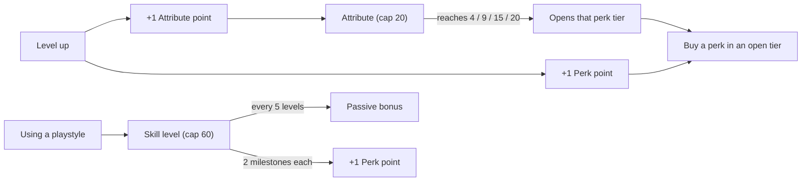
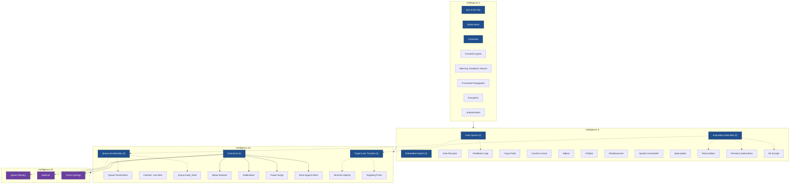
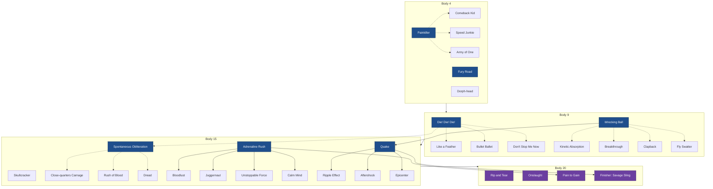

# Cyberpunk 2077 — Perks & Skills Flow Charts (Patch 2.x)

Reference charts for V's build. Perk names and tiers come from the Nukes & Dragons perk database and the GameLuster Cool guide; skill bonuses from the Fextralife Skills page. Phantom Liberty's Relic tree is not included.

## How points work

- Character creation: every attribute starts at 3, plus 7 points to place (creation cap reported as 6).
- Attribute points: 81 total with Phantom Liberty (level cap 60), 71 without (cap 50).
- Perk points: about 80 with Phantom Liberty, 70 without (one guide), including the 10 from skills.
- Respec: attributes can be reset **once** per playthrough; perks can be refunded **any time** (refund the end of a chain first).

### Per-point attribute bonuses

| Attribute | Each point gives | Skill it pairs with |
|---|---|---|
| Body | +2 max Health | Solo |
| Reflexes | +0.5% crit chance | Shinobi |
| Technical Ability | +2 Armor | Engineer |
| Intelligence | +4% RAM, +0.5% quickhack damage, +1% quickhack duration | Netrunner |
| Cool | +1.25% crit damage | Headhunter |

## Legend

- **Dark blue** = Milestone / major perk · **Purple** = Master perk (tier 20) · plain = regular perk
- `(2)` / `(3)` = number of ranks (each rank costs a perk point)
- **Solid arrow** = prerequisite stated by the source
- **Dashed arrow** = grouping inferred from the perk's description — check in game

---

## Intelligence

| Tier | Perk | Effect |
|---|---|---|
| 4 | Eye in the Sky | Highlights Access Points and cameras; Control/Covert quickhacks and Distract Enemies through cameras cost less RAM and last longer |
| 4 | Optimization | +35% RAM recovery |
| 4 | Carhacker | Vehicle quickhacks (depends on cyberdeck tier) |
| 4 | ForceKill Cypher | Access Point sequences 1 shorter (min 2) |
| 4 | Warning: Explosion Hazard | More explosion damage from hacked devices and quickhacked enemies |
| 4 | Proximate Propagation | Quickhacks up to 35% cheaper the closer you are |
| 4 | Encryption | Quickhacks 30% harder to trace |
| 4 | Subordination | Control quickhacks last twice as long on full-health enemies |
| 9 | Hack Queue | +1 Max RAM |
| 9 | Embedded Exploit | +10% RAM recovery |
| 9 | Acquisition Specialist | Smart weapon reticle 10% larger |
| 9 | Data Recycler | Neutralizing an enemy refunds 80% of their queued quickhacks' RAM |
| 9 | Feedback Loop | +25% RAM recovery per quickhack in a queue |
| 9 | Copy-Paste | Hacking a netrunner who targeted you spreads to their allies |
| 9 | Counter-a-hack | Counter-hack netrunners through walls, -1 RAM |
| 9 | Siphon | Monowire hits restore RAM |
| 9 | ICEpick | Combat quickhacks cost 1 less on Control/Covert/Distracted targets |
| 9 | Shadowrunner | Takedowns remove all trace progress |
| 9 | System Overwhelm | +7% quickhack damage per unique quickhack or DoT on target |
| 9 | Speculation | Combat-quickhack neutralizations refund 25% of costs on that target |
| 9 | Recirculation | Smart weapon neutralizations restore RAM |
| 9 | Precision Subroutines | +2% Smart weapon accuracy per Max RAM |
| 9 | No Escape | Shooting an expiring lock resets it |
| 15 | Queue Acceleration | +1 Max RAM |
| 15 | Overclock | +10% RAM recovery; unlocks Overclock (spend Health when out of RAM) |
| 15 | Target Lock Transfer | Smart weapon reticle 10% larger |
| 15 | Queue Prioritization | +50% upload speed on the first of 2+ queued hacks |
| 15 | Finisher: Live Wire | Monowire finisher that restores Health and RAM |
| 15 | Queue Hack_Root | First hack of each new category costs 1 less |
| 15 | Blood Daemon | During Overclock, neutralizing restores 40 Health per queued hack |
| 15 | Sublimation | During Overclock, RAM recovery also heals |
| 15 | Power Surge | Activating Overclock heals 5x Max RAM |
| 15 | Race Against Mind | During Overclock, quickhack damage rises as Health drops (up to +50%) |
| 15 | Terminal Velocity | Smart weapon kills boost projectile speed and lock range |
| 15 | Targeting Prism | Multiple Smart weapon locks |
| 20 | Queue Mastery | +1 queue size; last hack in a full queue costs 50% less and locks it; locked targets take +15% damage |
| 20 | Spillover | During Overclock, quickhacks 50% more likely to spread |
| 20 | Smart Synergy | During Overclock, Smart weapons lock instantly and deal +25% to hacked enemies |

---

## Reflexes

```mermaid
flowchart TD
    classDef milestone fill:#1f4e8c,color:#ffffff,stroke:#0b2d55
    classDef master fill:#6b3fa0,color:#ffffff,stroke:#3d1f63

    subgraph R4["Reflexes 4"]
        R4a["Stuntjock"]:::milestone
        R4b["Slippery"]:::milestone
        R4c["Multitasker"]
        R4d["Muscle Memory"]
        R4e["Power Slide"]
        R4f["Parkour!"]
    end

    subgraph R9["Reflexes 9"]
        R9a["Ready, Rested, Reloaded"]:::milestone
        R9b["Dash"]:::milestone
        R9c["Lead and Steel"]:::milestone
        R9d["Spice of Life"]
        R9e["Tunnel Vision"]
        R9f["Mind Over Matter"]
        R9g["Can't Touch This"]
        R9h["Steady Grip"]
        R9i["Mean Streak"]
        R9j["Mad Dash"]
        R9k["Flash and Thunderclap"]
        R9l["Seeing Double"]
        R9m["Bullet Time"]
        R9n["Bullet Deflect"]
    end

    subgraph R15["Reflexes 15"]
        R15a["Sharpshooter"]:::milestone
        R15b["Air Dash"]:::milestone
        R15c["Finisher: Bladerunner"]:::milestone
        R15d["Spray and Pray"]
        R15e["Shoot to Chill"]
        R15f["Practice Makes Perfect"]
        R15g["Gundancer"]
        R15h["Air Kerenzikov"]
        R15i["Aerial Acrobat"]
        R15j["Aerodynamic"]
        R15k["Going the Distance"]
        R15l["Opportunist"]
        R15m["Flash of Steel"]
    end

    subgraph R20["Reflexes 20"]
        R20a["Salt in the Wound"]:::master
        R20b["Submachine Fun"]:::master
        R20c["Tailwind"]:::master
        R20d["Slaughterhouse"]:::master
    end

    R4 --> R9 --> R15 --> R20

    R15a --> R15e & R15f
    KZ(["Kerenzikov cyberware"]) --> R15h
    R9a -.-> R9d & R9e & R9f
    R9a -.-> R15a
    R15a -.-> R15d & R15g
    R15a -.-> R20a & R20b
    R9b -.-> R9g & R9h & R9i & R9j
    R9b -.-> R15b
    R15b -.-> R15i & R15j
    R15b -.-> R20c
    R9c -.-> R9k & R9l & R9m & R9n
    R9c -.-> R15c
    R15c -.-> R15k & R15l & R15m
    R15c -.-> R20d
```

| Tier | Perk | Effect |
|---|---|---|
| 4 | Stuntjock | Jump-out/slide-out vehicle exits; less spread while driving |
| 4 | Slippery | Harder to hit the faster you move |
| 4 | Multitasker | Shoot while sprinting, sliding, vaulting |
| 4 | Muscle Memory | Reload while sprinting, sliding, vaulting |
| 4 | Power Slide | Longer slides |
| 4 | Parkour! | Faster vaulting and climbing |
| 9 | Ready, Rested, Reloaded | Lower stamina cost for AR/SMG fire |
| 9 | Dash | Lower stamina cost for dodging/dashing |
| 9 | Lead and Steel | Lower stamina cost for blade attacks |
| 9 | Spice of Life | Faster weapon swaps, brief spread reduction |
| 9 | Tunnel Vision | More range and accuracy |
| 9 | Mind Over Matter | Less recoil while aiming |
| 9 | Can't Touch This | Big mitigation chance during dashes |
| 9 | Steady Grip | Shoot while dashing |
| 9 | Mean Streak | Stamina back after a dash kill |
| 9 | Mad Dash | Double dash range toward enemies |
| 9 | Flash and Thunderclap | Strong attacks leap to nearby enemies |
| 9 | Seeing Double | More counterattack damage and stun chance |
| 9 | Bullet Time | Free, auto-crit deflections in slowed time |
| 9 | Bullet Deflect | Deflect blocked bullets toward the reticle |
| 15 | Sharpshooter | +15% aim speed |
| 15 | Air Dash | -20% dash stamina cost |
| 15 | Finisher: Bladerunner | -15% blade stamina cost |
| 15 | Spray and Pray | -10% hip-fire stamina cost |
| 15 | Shoot to Chill | +4% armor penetration per Sharpshooter stack (automatic weapons) |
| 15 | Practice Makes Perfect | +7% crit chance and crit damage per Sharpshooter stack |
| 15 | Gundancer | Aiming doesn't slow you; shoot while vaulting |
| 15 | Air Kerenzikov | Kerenzikov in midair suspends you, longer duration |
| 15 | Aerial Acrobat | Better midair control |
| 15 | Aerodynamic | +30% mitigation strength in midair |
| 15 | Going the Distance | Double finisher range |
| 15 | Opportunist | Staggered/stunned/blinded/bleeding enemies easier to finish |
| 15 | Flash of Steel | +25% move and attack speed for 6s after a finisher |
| 20 | Salt in the Wound | 7th consecutive hit on one target deals bonus damage |
| 20 | Submachine Fun | Faster SMG swaps with auto-reload, +22% fire rate after swapping |
| 20 | Tailwind | Air dashes cost no stamina; air dashes and double jumps restore 25 stamina |
| 20 | Slaughterhouse | Attacks, counters, and deflections cause bleeding; stamina per dismemberment |

---

## Body

| Tier | Perk | Effect |
|---|---|---|
| 4 | Painkiller | Slow Health regen in combat |
| 4 | Fury Road | More vehicle-collision damage, less to your vehicle |
| 4 | Dorph-head | Brief 100% mitigation after Blood Pump or a Health item |
| 4 | Comeback Kid | Regen rises as missing Health grows |
| 4 | Speed Junkie | +60% regen while sprinting |
| 4 | Army of One | More regen per nearby enemy |
| 9 | Die! Die! Die! | More crit chance at low stamina |
| 9 | Wrecking Ball | -15% stamina cost for blunt attacks |
| 9 | Like a Feather | No movement penalty with shotguns/LMGs/HMGs |
| 9 | Bullet Ballet | Less spread while moving |
| 9 | Don't Stop Me Now | More mitigation and strength below 33% stamina |
| 9 | Kinetic Absorption | Blocking restores stamina and briefly boosts blunt damage |
| 9 | Breakthrough | Strong attack hits briefly lower enemy armor |
| 9 | Clapback | More knockdown on defensive attacks, more stun on counters |
| 9 | Fly Swatter | Less ranged damage while blocking with blunt weapons |
| 15 | Spontaneous Obliteration | More crit chance at low stamina |
| 15 | Adrenaline Rush | +35 max Health; unlocks Adrenaline Rush |
| 15 | Quake | -15% blunt stamina cost; unlocks Quake |
| 15 | Skullcracker | Quick melee damage rises as stamina falls (up to +200%) |
| 15 | Close-quarters Carnage | Chance to obliterate up close with ranged attacks |
| 15 | Rush of Blood | Faster reload after dismembering |
| 15 | Dread | Lowers enemy armor vs. ranged; spreads on dismemberment |
| 15 | Bloodlust | During Adrenaline Rush, dismemberment adds Adrenaline |
| 15 | Juggernaut | During Adrenaline Rush, more speed and damage |
| 15 | Unstoppable Force | During Adrenaline Rush, immune to slows and non-damaging effects |
| 15 | Calm Mind | During Adrenaline Rush, decay delayed 3s |
| 15 | Ripple Effect | +15% Health per enemy hit by Quake |
| 15 | Aftershock | +30 stamina per enemy hit by Quake |
| 15 | Epicenter | Quake scales with a midair Superhero Landing |
| 20 | Rip and Tear | Shotgun hit doubles next quick melee, and vice versa |
| 20 | Onslaught | More LMG ammo refill on kills |
| 20 | Pain to Gain | During Adrenaline Rush, faster Health item recharge on kills |
| 20 | Finisher: Savage Sling | Blunt finisher: heals 20%, throws the enemy (kills it) |

---

## Technical Ability

```mermaid
flowchart TD
    classDef milestone fill:#1f4e8c,color:#ffffff,stroke:#0b2d55
    classDef master fill:#6b3fa0,color:#ffffff,stroke:#3d1f63

    subgraph T4["Technical Ability 4"]
        T4a["Glutton for War"]:::milestone
        T4b["Gearhead"]:::milestone
        T4c["First Aid"]
        T4d["Transfusion"]
    end

    subgraph T9["Technical Ability 9"]
        T9a["Health Freak"]:::milestone
        T9b["All Things Cyber"]:::milestone
        T9c["Borrowed Time"]
        T9d["Coming in Hot"]
        T9e["Field Medic"]
        T9f["Demolitions Surplus"]
        T9g["Renaissance Punk"]
        T9h["Chrome Constitution"]
        T9i["Lucky Day"]
        T9j["Driver Update"]
        T9k["Chipware Connoisseur"]
    end

    subgraph T15["Technical Ability 15"]
        T15a["Pyromania"]:::milestone
        T15b["License to Chrome"]:::milestone
        T15c["Bolt"]:::milestone
        T15d["Burn This City"]
        T15e["Heat Shield"]
        T15f["Flash Sale"]
        T15g["Friendlier Fire"]
        T15h["Doomlauncher"]
        T15i["Ambidextrous"]
        T15j["Cyborg"]
        T15k["Built Different"]
        T15l["Extended Warranty"]
        T15m["Internal Clock"]
        T15n["Lightning Storm"]
        T15o["Shock Value"]
        T15p["In Charge"]
    end

    subgraph T20["Technical Ability 20"]
        T20a["Ticking Time Bomb"]:::master
        T20b["Edgerunner"]:::master
        T20c["Chain Lightning"]:::master
    end

    T4 --> T9 --> T15 --> T20

    T15a --> T15d & T15e
    T15c --> T15m & T15n & T15o
    T4a -.-> T4c & T4d
    T9a -.-> T9c & T9d & T9e & T9f
    T9a -.-> T15a
    T15a -.-> T15f & T15g & T15h
    T9b -.-> T9g & T9h & T9j & T9k
    T9b -.-> T15b
    T15b -.-> T15i & T15j & T15k & T15l
    T15b -.-> T20b
    T15c -.-> T15p
    T15c -.-> T20c
```

| Tier | Perk | Effect |
|---|---|---|
| 4 | Glutton for War | Small Health item/grenade recharge on neutralizing |
| 4 | Gearhead | Tougher vehicles, stronger vehicle weapons |
| 4 | First Aid | Faster Health item recharge after one charge used |
| 4 | Transfusion | Last Health item charge heals more |
| 9 | Health Freak | Faster Health item and grenade recharge |
| 9 | All Things Cyber | All cyberware stat modifiers up |
| 9 | Borrowed Time | Instant Health item recharge on a kill when low and empty |
| 9 | Coming in Hot | Faster grenade recharge when out |
| 9 | Field Medic | Faster Health item use in combat |
| 9 | Demolitions Surplus | +1 grenade charge, faster recharge out of combat |
| 9 | Renaissance Punk | +4 Cyberware Capacity per attribute at 9+ |
| 9 | Chrome Constitution | Less damage taken with all Integumentary and Skeleton slots filled |
| 9 | Lucky Day | More crafting components from loot |
| 9 | Driver Update | Extra stat modifier on all cyberware |
| 9 | Chipware Connoisseur | Choice of stat modifiers when upgrading cyberware |
| 15 | Pyromania | Faster Health item and grenade recharge |
| 15 | License to Chrome | +10% all cyberware stat modifiers (Fextralife also lists a 3rd Skeleton slot) |
| 15 | Bolt | Faster tech weapon charge |
| 15 | Burn This City | 5 Pyromania stacks become a grenade charge |
| 15 | Heat Shield | Mitigation per Pyromania stack |
| 15 | Flash Sale | Double charges/recharge for Flash, Smoke, Recon grenades |
| 15 | Friendlier Fire | Less damage from your own explosions |
| 15 | Doomlauncher | Projectile Launch System charges and recharge |
| 15 | Ambidextrous | Second Hands cyberware slot |
| 15 | Cyborg | Shorter cyberware cooldowns with all slots filled |
| 15 | Built Different | Unlocks Cellular Adapter (Integumentary) |
| 15 | Extended Warranty | Longer cyberware effects |
| 15 | Internal Clock | Longer window to fire a Bolt |
| 15 | Lightning Storm | Faster charge after each Bolt shot |
| 15 | Shock Value | Bolt shots ignore armor |
| 15 | In Charge | Tech weapons stop auto-firing at full charge |
| 20 | Ticking Time Bomb | Delayed EMP after Berserk, Sandevistan, or Overclock |
| 20 | Edgerunner | Exceed Cyberware Capacity by up to 50 (-0.5% max Health per point over); kills can trigger Fury |
| 20 | Chain Lightning | Bolts deal Electrical damage and arc to 3 enemies |

---

## Cool

```mermaid
flowchart TD
    classDef milestone fill:#1f4e8c,color:#ffffff,stroke:#0b2d55
    classDef master fill:#6b3fa0,color:#ffffff,stroke:#3d1f63

    subgraph C4["Cool 4"]
        C4a["Killer Instinct"]:::milestone
        C4b["Feline Footwork"]:::milestone
        C4c["Road Warrior"]:::milestone
        C4d["Gag Order"]
        C4e["Quick Getaway"]
        C4f["Unexposed"]
        C4g["Small Target"]
        C4h["Blind Spot"]
    end

    subgraph C9["Cool 9"]
        C9a["Scorpion Sting (2)"]:::milestone
        C9b["Focus (2)"]:::milestone
        C9c["Parasite"]
        C9d["Neurotoxin"]
        C9e["Accelerated Toxin Absorption"]
        C9f["Corrosion"]
        C9g["No Sweat"]
        C9h["Rinse And Reload"]
        C9i["Pull!"]
        C9j["Head To Head"]
        C9k["Deep Breath"]
    end

    subgraph C15["Cool 15"]
        C15a["Deadeye (3)"]:::milestone
        C15b["Ninjutsu (3)"]:::milestone
        C15c["Juggler (3)"]:::milestone
        C15d["California Reaper"]
        C15e["High Noon"]
        C15f["Long Shot"]
        C15g["Quick Draw"]
        C15h["Serpentine"]
        C15i["Shinobi Sprint"]
        C15j["Creeping Death"]
        C15k["Vanishing Act"]
        C15l["Pay It Forward"]
        C15m["Sleight Of Hand"]
        C15n["Finisher: Act Of Mercy"]
        C15o["Pounce"]
    end

    subgraph C20["Cool 20"]
        C20a["Nerves Of Tungsten-Steel"]:::master
        C20b["Run'N'Gun"]:::master
        C20c["Style Over Substance"]:::master
    end

    C4 --> C9 --> C15 --> C20

    C9j --> C9k
    C15n --> C15o
    OC(["Optical Camo cyberware"]) --> C15k
    C4a -.-> C4d & C4e
    C4b -.-> C4f & C4g & C4h
    C4b -.-> C15b
    C9a -.-> C9c & C9d & C9e & C9f
    C9a -.-> C15c
    C9b -.-> C9g & C9h & C9i & C9j
    C9b -.-> C15a
    C15a -.-> C15d & C15e & C15f
    C15a -.-> C20a
    C9b -.-> C20b
    C15b -.-> C15h & C15i & C15k
    C15c -.-> C15m
    C15b -.-> C20c
    C15c -.-> C20c
```

| Tier | Perk | Effect |
|---|---|---|
| 4 | Killer Instinct | +25% knife, axe, silenced weapon damage outside combat |
| 4 | Feline Footwork | +15% speed and mitigation while crouched |
| 4 | Road Warrior | Sandevistan while driving, Kerenzikov while aiming + handbraking, +25% damage drifting/airborne |
| 4 | Gag Order | Hitting a target right after detection delays nearby detection |
| 4 | Quick Getaway | +10% speed after an undetected kill (stacks 2) |
| 4 | Unexposed | +20% mitigation aiming from cover |
| 4 | Small Target | +20% mitigation crouched and still |
| 4 | Blind Spot | Longer detection time, scaled by crouched mitigation |
| 9 | Scorpion Sting | -15% throwable recovery; rank 2: throwable crits poison |
| 9 | Focus | +10% headshot/weak-spot damage (pistols, revolvers, precision, sniper); rank 2: Focus Mode |
| 9 | Parasite | Heal 15 on throwable crits/headshots |
| 9 | Neurotoxin | Poison also blinds and stops sprinting |
| 9 | Accelerated Toxin Absorption | Strong attacks/throwables on poisoned targets cash in the poison |
| 9 | Corrosion | Poison works on machines |
| 9 | No Sweat | Cheaper Focus Mode per kill |
| 9 | Rinse And Reload | +10% reload after an aimed kill |
| 9 | Pull! | Easier to shoot grenades in Focus Mode |
| 9 | Head To Head | Ranged kill in Focus Mode resets it |
| 9 | Deep Breath | Focus slows time 25% |
| 15 | Deadeye | More headshot damage, less shooting stamina; rank 3: Deadeye Mode |
| 15 | Ninjutsu | More crouch speed and mitigation; rank 3: crouch-sprint |
| 15 | Juggler | Faster throwable recovery, +20% throwable headshot damage; rank 3: cooldown reset on kills |
| 15 | California Reaper | Stamina back on ranged headshot kills |
| 15 | High Noon | Faster reload and slowed time after headshot kills |
| 15 | Long Shot | Full damage at any range in Deadeye Mode |
| 15 | Quick Draw | Faster swaps, stamina back on swap in combat |
| 15 | Serpentine | +30% mitigation while crouch-sprinting |
| 15 | Shinobi Sprint | -75% crouch-sprint stamina cost in combat |
| 15 | Creeping Death | Heal, stamina, speed after an undetected or camo kill |
| 15 | Vanishing Act | Optical Camo auto-activates while crouch-sprinting or sliding (needs Optical Camo) |
| 15 | Pay It Forward | First melee with a retrieved throwable +200% damage |
| 15 | Sleight Of Hand | Juggler procs stack +20% crit damage |
| 15 | Finisher: Act Of Mercy | Throwable finisher on low-Health enemies; triggers Juggler, heals 25% |
| 15 | Pounce | Longer Act Of Mercy range on enemies hit by throwables |
| 20 | Nerves Of Tungsten-Steel | Guaranteed crits on headshots in Deadeye Mode, distance damage bonus |
| 20 | Run'N'Gun | Pistols: no hip-fire stamina cost, +25% speed in Focus |
| 20 | Style Over Substance | Guaranteed crits while crouch-sprinting, sliding, dodging, dashing; no aiming penalty for throwables |

---

## Skills (level 1–60, raised by use)

Perk points from skills: levels 15 and 35 (Solo: 30 and 35).

```mermaid
flowchart LR
    classDef pp fill:#2f6b2f,color:#ffffff,stroke:#174017
    NR["Netrunner (INT)"] --> N5["5: +5% RAM recovery"] --> N10["10: +1 RAM"] --> N15["15: +1 Perk point"]:::pp --> N20["20: +20% Smart lock-on range"] --> N25["25: +5% RAM recovery"] --> N30["30: +1 RAM"]
    N30 --> N35["35: +1 Perk point"]:::pp --> N40["40: -20% RAM cost on devices and vehicles"] --> N45["45: +15% Control/Covert duration, +5% Combat damage"] --> N50["50: +40% Overclock duration"] --> N55["55: -10% Health loss in Overclock"] --> N60["60: Overclock reveals enemies within 10m, hack through cover"]
```

```mermaid
flowchart LR
    classDef pp fill:#2f6b2f,color:#ffffff,stroke:#174017
    SH["Shinobi (REF)"] --> S5["5: +5% move speed"] --> S10["10: -5% dodge/dash stamina"] --> S15["15: +1 Perk point"]:::pp --> S20["20: Accuracy boost after dodge/dash"] --> S25["25: +5% move speed"] --> S30["30: -10% dodge/dash stamina"]
    S30 --> S35["35: +1 Perk point"]:::pp --> S40["40: Mitigation rises with speed"] --> S45["45: +25% Fast Attack damage"] --> S50["50: Air Dash and slides reload 20%"] --> S55["55: Low stamina no penalty midair or in slowed time"] --> S60["60: Sandevistan +40% crit chance, free movement"]
```

```mermaid
flowchart LR
    classDef pp fill:#2f6b2f,color:#ffffff,stroke:#174017
    EN["Engineer (TECH)"] --> E5["5: +15 Armor"] --> E10["10: +5 Cyberware Capacity"] --> E15["15: +1 Perk point"]:::pp --> E20["20: +10% grenade damage and radius"] --> E25["25: +25 Armor"] --> E30["30: +10 Cyberware Capacity"]
    E30 --> E35["35: +1 Perk point"]:::pp --> E40["40: More Shock chance from tech weapons and electric baton"] --> E45["45: +15% Health item effectiveness"] --> E50["50: +30% all cyberware stat modifiers"] --> E55["55: Bolt +10% damage, +40% Burn"] --> E60["60: Fury releases EMP blasts"]
```

---

## Sources

- Perks: [Nukes & Dragons — Intelligence](https://nukesdragons.com/cyberpunk-2077/db/attributes/intelligence), [Reflexes](https://nukesdragons.com/cyberpunk-2077/db/attributes/reflexes), [Body](https://nukesdragons.com/cyberpunk-2077/db/attributes/body), [Technical Ability](https://nukesdragons.com/cyberpunk-2077/db/attributes/technical), [Cool](https://nukesdragons.com/cyberpunk-2077/db/attributes/cool); [GameLuster — Cool tree](https://gameluster.com/?p=97755); [Fextralife — Intelligence](https://cyberpunk2077.wiki.fextralife.com/Intelligence)
- Skills: [Fextralife — Skills](https://cyberpunk2077.wiki.fextralife.com/Skills)
- Points, caps, respec: [GGRecon — perk points](https://www.ggrecon.com/guides/cyberpunk-2077-max-perk-points/), [PC Gamer — level cap](https://pcgamer.com/cyberpunk-2077-max-level-cap), [Prima Games — creation cap](https://primagames.com/gaming/cyberpunk-2077-skills-guide-perks-attributes/2), [Game8 — respec](https://game8.co/games/Cyberpunk-2077/archives/Respec)
- Cyberware notes: [Fextralife — Cyberware](https://cyberpunk2077.wiki.fextralife.com/Cyberware)
