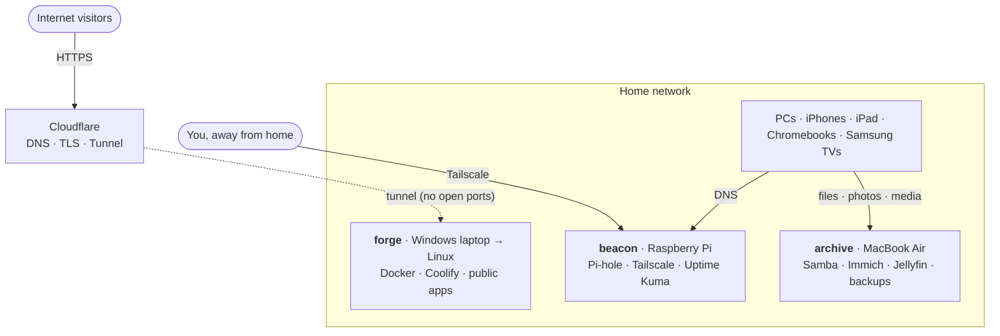

# homeLab

A home server built from retired laptops and Raspberry Pis. It has two jobs:

1. **Private household services:** network-wide ad blocking, file and photo backup, media for the TVs, and remote access from anywhere.
2. **Public hosting:** internet-facing web services and personal programming projects.

Everything that configures the lab (compose files, configs, notes) lives in this folder on the `homeLab` branch, so any box can be rebuilt from scratch.

> **Assumption:** the server is built from the old Windows laptop, the MacBook Air and the Pis. Every other device listed below is a client of the lab.

---

## Inventory

### Server hardware

| Device | Today | Proposed OS | Proposed role | Specs to confirm |
|---|---|---|---|---|
| Old Windows laptop | Windows | Debian 13, headless | **`forge`**: main compute. Docker, dev projects, public web apps | CPU, RAM, SSD/HDD, battery health |
| MacBook Air | macOS | Depends on the model (see [Hardware prep](#hardware-prep)) | **`archive`**: personal data. Files, photos, media, backups | Year, Intel or Apple Silicon, RAM |
| Raspberry Pi(s) | ? | Raspberry Pi OS Lite (64-bit) | **`beacon`**: always-on network services. DNS, VPN, monitoring | How many, which models (3/4/5), RAM |

The roles may swap once specs are known. For example, an Intel laptop with Quick Sync is the better Jellyfin host.

### Clients

| Device | Qty | What the lab gives them |
|---|---|---|
| Win11 desktop | 1 | Main admin and dev workstation: VS Code Remote-SSH into `forge`, mapped network drives, Tailscale, backups to `archive` |
| Win11 laptops | 2 | Tailscale, network drives, backups to `archive`, SSH for dev work |
| iPhones | 3 | Tailscale, photo backup (Immich), Jellyfin app, ad blocking at home *and* away (Tailscale DNS → Pi-hole) |
| iPad | 1 | Same as the iPhones, plus the Files app connected to the SMB shares |
| Samsung smart TVs | 2 | Jellyfin (Tizen app or plain DLNA); DNS-level blocking of TV ads and telemetry |
| Chromebooks | 2 | Tailscale (Android app), web dashboards, Linux dev environment (Crostini) for SSH |

---

## Architecture

### Design principles

1. **No inbound ports open on the router.** Public traffic reaches `forge` through a Cloudflare Tunnel, an outbound connection from inside the house. This works even if the ISP uses CGNAT, it hides the home IP, and TLS certificates are free.
2. **Admin access stays private.** SSH, dashboards and Docker UIs are reachable only on the LAN or over Tailscale, never through the tunnel.
3. **Public apps and personal data live on different machines.** A compromised web app on `forge` doesn't land next to the family photos on `archive`.
4. **Everything is code.** Compose files and configs are committed here, and secrets stay out of git (`.env` files are gitignored).
5. **Backups come before data.** Nothing irreplaceable, such as photos, moves onto the lab until backups work and a restore has been tested.

---

## Services (proposed)

| Service | Host | Purpose | Reachable from |
|---|---|---|---|
| Pi-hole | beacon | Network-wide ad/tracker blocking, local names (`forge.home.arpa`) | LAN + Tailscale |
| Tailscale | every server + client | Private remote access from anywhere; `beacon` as subnet router and exit node | Private |
| Uptime Kuma | beacon | Uptime checks with phone alerts | Private |
| Homepage | beacon | One dashboard linking everything | Private |
| Docker + Compose | forge, archive | Every service runs as a container | — |
| Coolify | forge | Self-hosted Heroku: push to git and the project deploys. Ships its own reverse proxy | Admin UI private; apps public |
| cloudflared | forge | Cloudflare Tunnel; only explicitly listed hostnames are published | Public |
| Samba | archive | Shared drives for Windows, the Mac and the iOS Files app | LAN + Tailscale |
| Immich | archive | iPhone/iPad photo backup (a Google Photos replacement) | Private |
| Jellyfin | archive (or forge) | Movies and TV for the Samsung TVs and phones | Private (remote via Tailscale) |
| restic or Kopia | archive | Backups to an external drive plus offsite (e.g. Backblaze B2) | — |

Notes:
- **Keep Jellyfin off the public tunnel.** Cloudflare's terms restrict proxying video, and remote streaming over Tailscale works fine.
- **Use Cloudflare Access** (free tier) for any app that should be on the internet but only for you or your family. It puts a login in front without code changes.

---

## Network

**Questions for the router:** can it set the DNS server it hands out via DHCP, make DHCP reservations, run a guest network, and do VLANs?

Proposed static addresses (subnet TBD, e.g. `192.168.1.0/24`):

| Address | Host |
|---|---|
| .1 | router |
| .2 | beacon (Pi-hole: primary DNS) |
| .3 | second Pi, if any (backup DNS) |
| .10 | forge |
| .11 | archive |

**The TV question.** Smart TVs are chatty and rarely patched, so ideally they'd sit on an isolated network. A plain guest network usually blocks *all* LAN access, though, so the TVs couldn't reach Jellyfin. The options:
- **(a)** Keep the TVs on the main LAN and rely on Pi-hole to block their ads and telemetry. This is the simplest.
- **(b)** Use a router with VLANs and firewall rules: an IoT VLAN that can reach only `archive:8096`. This is the best isolation and needs capable hardware (or OpenWrt).

---

## Hardware prep

**Laptops as servers**
- Set lid close to do nothing (`HandleLidSwitch=ignore` in `/etc/systemd/logind.conf`) and disable sleep.
- The battery is a free UPS, but charging it 24/7 wears it out and can make it **swell**. Set a charge limit of ~60–80% in BIOS or with TLP if supported, check for bulging every month, and pull any battery that's already puffy.
- Use wired Ethernet. The Air needs a USB-C/USB Ethernet adapter.
- In BIOS, enable "power on after AC loss" if it exists, so the machine comes back after an outage.

**MacBook Air: depends on the model**
- **Intel, 2017 or earlier:** Debian installs normally. The Wi-Fi is Broadcom, so use Ethernet.
- **Intel, 2018–2020 (T2 chip):** Linux needs the [t2linux](https://t2linux.org) kernel and Secure Boot relaxed in the Startup Security Utility. It's doable but fiddly.
- **Apple Silicon (M1/M2):** [Asahi Linux](https://asahilinux.org) (Fedora Asahi Remix) works well headless. On newer chips, check Asahi's support status.
- **Fallback for any model:** keep macOS and run Docker through OrbStack or Colima. This is easy, but macOS fights you on sleep and auto-updates.

**Raspberry Pis**
- Boot from a USB SSD (or NVMe on a Pi 5) instead of microSD. Constant DNS logging wears out SD cards.
- Use the official power supply, because undervoltage causes weird instability.
- A Pi 3 is plenty for Pi-hole. Save a Pi 4/5 for heavier jobs.

---

## Roadmap

- [ ] **Phase 0: Inventory.** Answer the [open questions](#open-questions) and fill in the specs above.
- [ ] **Phase 1: Foundation (`beacon`).** Flash the Pi, add SSH keys, then set up Tailscale and Pi-hole. Point router DHCP at Pi-hole and reserve the static IPs.
- [ ] **Phase 2: Servers.** Wipe the laptops and install Linux. Then set up SSH keys only (no passwords), `unattended-upgrades`, a firewall (ufw), Docker and Tailscale.
- [ ] **Phase 3: Private services.** Samba, then backups (external drive + offsite), then a **restore test**, then Immich and Jellyfin.
- [ ] **Phase 4: Public hosting.** Move the domain onto Cloudflare, run cloudflared on `forge`, and publish a first static page. Then set up Coolify for personal projects.
- [ ] **Phase 5: Polish.** Uptime Kuma alerts to phones, the Homepage dashboard, Cloudflare Access on semi-private apps, and a written rebuild runbook per host.

---

## Household privacy

[`privacy.md`](privacy.md) is a checklist of device and account settings that cut tracking on every device in the house, plus the lab pieces (Pi-hole, email aliases) as they come online. Most of it needs no server and can be done today.

---

## Projects

Ideas to build on the lab once it's running. Each has its own file in [`projects/`](projects/).

| Project | Summary | Needs |
|---|---|---|
| [Ad replacement](projects/adReplacement.md) | Browser extension that fills blocked ad spaces with our own content (photos, calendar, story snippets, lab status) | Phases 2–3 |

---

## Open questions

1. **Raspberry Pis:** how many, and which models and RAM?
2. **Windows laptop:** CPU, RAM, storage (SSD or HDD)? Is the battery healthy?
3. **MacBook Air:** what year, Intel or Apple Silicon, how much RAM?
4. **Can both laptops be wiped** and dedicated to the lab, or does either need to stay usable as a computer?
5. **Router:** make and model? Is it ISP-supplied?
6. **ISP:** public IPv4 or CGNAT? (The tunnel works either way. This just tells us what other options exist.)
7. **Domain:** do you own one? Is its DNS on Cloudflare, or could it move there?
8. **Storage:** any external USB drives for media and backups?
9. **First projects to publish:** static sites, APIs, Node/Python apps, databases?
10. **People:** who uses the three iPhones? Does everyone get their own Tailscale/Immich/Jellyfin login?
