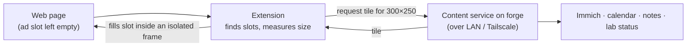

# Ad replacement

**Status:** idea. Comes after the lab's core services are running.

A browser extension that finds the empty spaces left by blocked ads and fills them with our own content, served from the lab: family photos, the calendar, notes, story snippets from this repo, lab status.

## Why a browser extension

Pi-hole can point blocked ad domains at our own server, but almost every ad loads over HTTPS. The browser expects a certificate for the ad company's domain, ours can't provide one, so nothing shows. An extension avoids that problem because it works inside the page after it loads. It can find each ad slot and put anything there.

## How it works

1. **Find the slots.** Match known ad containers, such as Google's `ins.adsbygoogle`, `div[id^="div-gpt-ad"]` and iframes from ad domains. Later this could reuse the element-hiding rules from EasyList, the same lists Adblock Plus uses.
2. **Measure them.** Most ads use standard sizes: 300×250, 728×90, 160×600, 320×50 and 300×600.
3. **Ask the lab for a tile** that fits the size.
4. **Fill the slot** inside an isolated frame (see [Privacy](#privacy)).

## Content ideas

- Photo of the day from Immich
- Today's events from the family calendar
- A random passage from the stories in this repo
- Lab status from Uptime Kuma ("all systems up", or what's down)
- Weather, reminders, to-dos

## Privacy

Anything placed directly into a web page can be read by that site's scripts, including the ad and tracking scripts we're trying to avoid. **Tiles must render in a frame the page can't read**, such as an extension-owned iframe, so a news site never sees family photos or calendar entries.

Also remember the content is visible to anyone looking at the screen. Keep sensitive sources opt-in.

## Open questions

- **Working alongside Adblock Plus.** ABP collapses ad containers with its own hiding rules, which would hide our tiles too. Either this extension takes over element hiding (ABP still blocks the network requests), or we add exceptions in ABP. The prototype will tell us which is cleaner.
- **Site security rules.** Some sites' Content Security Policies may block injected frames or images. We need to test on the sites we actually use.
- **Reaching the lab from the browser.** Use a name with a valid certificate (Tailscale's `*.ts.net` certificates, or Caddy with our own domain), so it works at home and away.

## Milestones

1. **Prototype:** a Firefox extension that fills ad slots on a few test sites with a static image bundled in the extension.
2. **Content service:** a small API on `forge` that returns a tile for a given size.
3. **Real content:** Immich photos, the calendar, story snippets, lab status.
4. **Chrome/Edge build** for the Windows PCs and Chromebooks (mostly the same code, since both use the WebExtensions API).
5. **Stretch: Safari** for the iPhones and iPad. This needs Xcode on a Mac and an Apple developer account to install.

## Depends on

- Phase 2 (`forge` running Docker) for the content service
- Phase 3 (Immich) for photos
- Tailscale for use away from home
