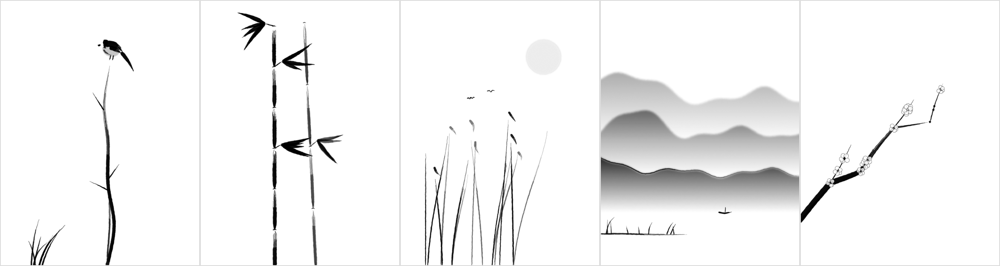

# Ink Art: Illustrations for the Pen Practice Books

Two sources of illustration, both safe to publish:

1. **Generated ink art**: `ink.mjs` draws new brush-and-ink scenes from code. Every seed gives a new image.
2. **Public-domain art**: old master paintings and naturalist books, used under the rules below.



## Generated ink art

- **Style**: naturalist and minimal, in the spirit of sumi-e and Musashi's *Shrike on a Withered Branch*.
  - dry-brush strokes built from bristles that run out of ink ("flying white")
  - soft washes and ragged ink-bleed edges
  - lots of empty paper
- **These are original compositions**, not copies of any painting.
- **Scenes**: `shrike` (lone bird on a bare branch), `bamboo`, `reedsMoon`, `mountains` (misty ranges, a boat), `plum` (old limb with blossoms).
- **Output**: one vector **SVG** (for print, any size) and one **PNG** at Kindle Scribe resolution per scene, dithered to the screen's 16 grays.

```sh
cd inkArt
node ink.mjs --seed 7                  # new set of 5 scenes + contact sheet in out/
node ink.mjs --seed 7 --size 2480x3508 # A4 at 300 dpi for print
```

Needs Playwright (Chromium) and ImageMagick.

- **Uses in the books**:
  - covers and part openers
  - "Why it works" pages
  - **brush and line warm-ups**: trace a generated branch or reed stroke for stroke confidence
  - **copy-the-picture exercises** (the gentle end of "sketch what you see")
- **Limit**: drawing from life still needs real things. Keep the "draw something near you" prompts and the photo or naturalist references for the seeing lessons.

## Public-domain art: the rules

- **The artwork must be out of copyright.**
  - A common rule is the artist's death plus 70 years. Japan, for older works, uses death + 50.
  - Pre-1900 work is safe almost everywhere.
  - Musashi died in 1645, so his paintings are public domain.
- **The photo of the artwork can matter.**
  - **US**: a faithful photo of a 2D public-domain work isn't copyrightable (*Bridgeman v. Corel*, 1999).
  - **EU**: Article 14 of the 2019 copyright directive says the same for public-domain visual art, though national details vary.
  - **Safest**: use images the holding institution releases as **CC0 / public domain** (the Met, Smithsonian, Art Institute of Chicago, Cleveland Museum of Art, Rijksmuseum, and the National Diet Library Image Bank in Japan), or **Wikimedia Commons** files tagged **PD-Art**.
  - Some museums only allow educational use. **Skip those** for paid products.
- **Credit the work** even when it isn't required: "Miyamoto Musashi, *Shrike on a Withered Branch*, 17th c. Public domain." Don't use a museum's name or logo in a way that suggests endorsement.
- **Log every image** in `licences.csv` before it goes in a book: source URL, licence/status, and the date checked.
- **Prepare for e-ink**: convert to grayscale, lift contrast, and dither to 16 grays. Run the image through the same `convert` step used in `ink.mjs`.

## Good public-domain sources for a naturalist, ink look

| Source | What | Where to look |
|---|---|---|
| **Miyamoto Musashi** (d. 1645) | Ink birds and branches (*Shrike on a Withered Branch*, *Bird on Branch*) | Wikimedia Commons (PD-Art). Check each file's source, because some museum pages are education-only |
| **Kōno Bairei**, *Bairei hyakuchō gafu* (1881) | 100 birds: perfect drawing references | Smithsonian Libraries, University of Wisconsin, Met |
| **Bird-and-flower albums** (Bairei, Keibun, Keinen) | Plants and birds in brush style | National Diet Library Image Bank (public-domain gallery), University of Kansas |
| **Hokusai** sketch books (*gafu*, *Manga*) | Figures, animals, plants, in quick confident lines | University of Pennsylvania (Colenda), Smithsonian, NDL |
| **Western naturalists** (Audubon, Haeckel, old botanical plates) | Carefully observed birds, plants, shells | Biodiversity Heritage Library, museum open-access collections |

**Best use in the sketch book: "master copy" plates.** A public-domain painting on one page, a blank or gridded page next to it, and a short note on what to look for. Copying masters is a classic way to learn to see.
