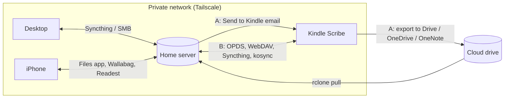

# Kindle Scribe as a Hub Device

Goal: link the Scribe, iPhone, desktop and home server so that:

1. The Scribe can reach files on the home server.
2. Everything I make on the Scribe (notes, marked-up PDFs) lands back on the server.
3. The Scribe does more than hold books.

Which path I can take depends on the model:

| Scribe | Path |
|---|---|
| 2022 or 2024, on firmware Vera supports (see `kindleScribeCustomization.md`) | **B: jailbroken**. Far more capable |
| 3rd gen (2025) or Colorsoft | **A: stock**, plus the Google Drive / OneDrive / OneNote links Amazon added for 2025+ Scribes |

---

## The shape of it

**The home server is the hub.** Every device syncs with it, never directly with each other. This matters most for the iPhone, which can't stay online in the background (see Phase 1).

---

## Phase 1: plumbing (do this first, whichever path)

- **Tailscale** on the server, desktop and iPhone. This gives one private network that works away from home, and nothing on the server is exposed to the internet. On Path B, the Scribe joins too, through the Tailscale KUAL extension.
- **Make a folder structure on the server**:
  - `/scribe/inbox`: anything I want on the Scribe.
  - `/scribe/out`: notes and marked-up PDFs coming back.
  - `/scribe/library`: books.
- **Desktop**: map the server share, or run Syncthing against it.
- **iPhone**: connect to the share in the Files app (Connect to Server, SMB), or use **Möbius Sync** (Syncthing for iOS). iOS only lets it sync while the app is open or during short background windows the system schedules, every 5 to 15 minutes at best. That's why the always-on server is the hub.

---

## Path A: stock Scribe (any model; the only option for 3rd gen and Colorsoft)

### Files in (server → Scribe)

- **Send to Kindle by email** is the stock way in. It accepts PDF, DOCX, TXT, RTF, HTML, EPUB and images.
  - **Calibre-Web** on the server has a built-in Send to Kindle button for the book library. It needs an SMTP mailbox (with a Gmail app password, for example), and the sending address must be on Amazon's Approved Senders list.
  - **Inbox watcher** (to build): a small server script that emails anything dropped into `/scribe/inbox` to my Kindle address. That gives the desktop and iPhone one drop target.
- **iPhone / desktop direct**: Share sheet → Kindle app (Send to Kindle), or the Send to Kindle desktop app.
- **2025+ Scribes only**: import from Google Drive or OneDrive (PDF, DOC/DOCX, PPT, EPUB, images, under 200 MB). Use **rclone** on the server to mirror `/scribe/inbox` to a Drive folder, so server files show up in the Scribe's import list.

### Notes out (Scribe → server)

- **2025+ Scribes**:
  - Export marked-up PDFs to Drive or OneDrive.
  - Export notebooks to OneNote as handwriting images, converted text, or both.
  - Amazon says this is **manual and one-way**, not automatic sync. One third-party guide claims auto-upload arrived in 5.19.2, so check on the device.
  - Then rclone pulls the Drive export folder down to `/scribe/out`.
- **2022/2024 stock**: share a notebook by email as a PDF, then save the attachment to `/scribe/out`.

### What else it can do on stock (2025+ models)

- AI search across all notebooks in plain language, and summaries of up to 15 pages.
- **Send to Alexa+**: Alexa turns a notebook into to-dos, calendar events and reminders. Needs Prime or Alexa+.
- Writing directly on PDFs I send to it, as a markup station for documents from the server.

---

## Path B: jailbroken Scribe (2022/2024)

KOReader plus the Scribe-specific plugin suite turns the Scribe into a real client on the home network.

### Reaching the server's files

- **Tailscale (KUAL)**: the Scribe reaches the server from anywhere, not just on home Wi-Fi.
- **KOReader cloud storage over WebDAV**: browse and open files on the server directly. Any WebDAV share works, such as Nextcloud, rclone serve, or a NAS's built-in WebDAV.
- **KOReader OPDS catalog**: browse and download from **Calibre-Web, Kavita or Komga** on the server.
- **Syncthing**, from kindle-koreader-apps or Kindle File Manager: two-way sync between a Kindle folder and the server's `/scribe/inbox` and `/scribe/out`.

### Linking the iPhone and desktop

- **Reading progress sync**: self-host a KOReader sync server (the official Docker image, or the lighter **kosync-dotnet** / **korrosync**).
  - On the iPhone, **Readest** speaks the same protocol, so I can pick up a book on the phone where I stopped on the Scribe.
  - Caveat: Readest won't sync backwards to an earlier position, and cross-app positions can drift.
- **Read-later**: self-host **Wallabag**.
  - Save articles from the iPhone share sheet (Wallabag app) or a desktop browser extension.
  - KOReader's Wallabag plugin downloads unread articles as EPUBs and marks them read on the server when I finish.
- **Send to KOReader**: KoSend (Android only), Calibre Wireless, or just drop files into the Syncthing folder.

### Capture and dashboards

- **kindle-koreader-apps Notes**: handwritten notebooks with search and export, plus OneNote sync. Exports land in the Syncthing folder and so reach the server.
- **Local handwriting-to-text**: the suite's optional AI can use a **local model such as Ollama**. Run it on the home server and handwriting is turned into text without leaving the house.
- **Home Assistant dashboard**: lights, locks and cameras on the e-ink screen. It works as a wall or desk panel when I'm not reading.
- **Microsoft To Do** sync, **SSH** into the server, and a **web server** for managing the Kindle from the phone or desktop.

---

## What "wider value" looks like in practice

| Role | Path A (stock) | Path B (jailbroken) |
|---|---|---|
| One inbox for everything (books, docs, articles) | Inbox watcher emails it over | Syncthing + OPDS + Wallabag |
| Review station: mark up docs, result back on server | Write on PDF → export to Drive → rclone | Annotate → Syncthing to `/scribe/out` |
| Handwriting → searchable text on server | OneNote export (text) → rclone | Notes + local Ollama OCR → Syncthing |
| Continue reading on the phone | Kindle app (Amazon books only) | kosync + Readest (any book) |
| At-a-glance panel | n/a | Home Assistant dashboard |
| Act on notes (to-dos, calendar) | Send to Alexa+ | Microsoft To Do plugin |

---

## Cautions

- **Keep everything on the tailnet.** Don't port-forward Calibre-Web, WebDAV, kosync or Wallabag to the internet.
- **Jailbreak**: block OTA updates after jailbreaking, and back up first. The 2026 firmware history (5.19.2 / 5.19.3 battery drain) is a reason to choose your firmware version deliberately.
- **Approved senders**: Send to Kindle silently drops mail from addresses that aren't on the list.
- **Mixing sync methods**: don't point Syncthing and WebDAV at the same folder from the Kindle.

## Open questions

- Which Scribe and firmware version? That decides Path A or B.
- What does the home server run (plain Linux, Unraid, TrueNAS, Synology)? That decides how to deploy Calibre-Web, kosync, Wallabag and Ollama.
- Desktop OS?

## Sources

- Scribe ↔ Google Drive / OneDrive / OneNote (Amazon): https://www.amazon.com/gp/help/customer/display.html?nodeId=TP8wuaQilIlwlITVTL
- Scribe 2025 features (Alexa+, AI search): https://www.aboutamazon.com/news/devices/kindle-scribe-new-features
- OneNote integration details: https://templacity.com/kindle-scribe/kindle-scribe-onenote-integration-2025/
- KOReader content and sync plugins (OPDS, cloud storage, Wallabag): https://deepwiki.com/koreader/koreader/9.3-content-and-sync-plugins
- KOReader + Wallabag in practice: https://planet.kde.org/matija-suklje-hook-2025-05-24-trying-out-koreader-and-wallabag-the-first-few-days-and-months
- kosync-dotnet: https://github.com/jberlyn/kosync-dotnet
- korrosync: https://docs.rs/crate/korrosync/latest
- Readest ↔ KOReader sync: https://github.com/readest/readest/wiki/Sync-with-Koreader-devices
- Readest (iOS): https://apps.apple.com/us/app/id6738622779
- Möbius Sync FAQ (iOS background limits): https://mobiussync.com/faq
- Calibre-Web Kindle email setup: https://www.github.com/janeczku/calibre-web/wiki/Additional-Configuration-for-Kindle-E-Mail
- Tailscale for Kindle (KUAL): https://github.com/mitanshu7/tailscale_kual
- kindle-koreader-apps: https://github.com/Mcp20091/kindle-koreader-apps
