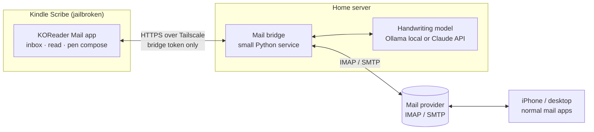

# Email on a Jailbroken Kindle Scribe

Goal: on a jailbroken Scribe:

- read my email
- write replies and new messages **by hand**
- have the handwriting transcribed to text
- check it, then send it as a normal email from my own address

Builds on `kindleScribeHub.md`: the home server is the hub, and everything runs over Tailscale.

---

## What exists today (Nov 2026)

There is **no finished email client for KOReader**. The pieces I found:

| Piece | What it does | State |
|---|---|---|
| **sendtokoreader.koplugin** (finlater) | Read-only IMAP over TLS. Pulls ebook attachments; leaves messages and their read state unchanged | MIT. Not tested on a physical Kindle. Stores credentials unencrypted |
| **ilmail_k3.koplugin** (senikolo, draft PR) | Inbox (last 12 headers), plain-text message preview, SMTP send up to 5000 characters | Test build for a Kindle Keyboard 3. Not yet tested with a real mailbox or device. Reuses finlater's IMAP/MIME code |
| **emailtokoreader / MailPush** | Email-to-device ebook delivery | Not a mail reader |
| **kindle-koreader-apps** (Mcp20091) | Pen notebooks with **AI handwriting-to-text** (Claude, Gemini, OpenRouter, Groq, Ollama, LM Studio, or any OpenAI-compatible API). `MAKING-AN-APP.md` explains how to add a new app to its launcher, settings and web page | AGPL-3.0. Scribe only |
| **Stock Scribe notebooks**, still there after a jailbreak | Share → **Convert to text and email**: preview, edit each page, send | Recipients get a **.txt file**, sent through Amazon, not from my address |

The pen, the handwriting recognition and the KOReader app framework all exist. Nobody has joined them to a mailbox yet.

---

## Three ways to get there

### Option 1: works today, no code (stopgap)

1. Write in a stock Scribe notebook.
2. Share → **Convert to text and quick send** to my own address.
3. On the iPhone, copy the text into a reply and send it.

It's clunky, but it proves out the handwriting step. A server rule could automate step 3 later: catch Amazon's email, read `To:` / `Subject:` from the first lines of the .txt, and save it as a draft in my mailbox.

### Option 2: terminal mail, no pen

SSH from the Scribe (KTerm, or the suite's SSH app) into the home server and run **aerc** or **neomutt** there. Reading is fine. Writing means the on-screen keyboard, so this misses the point. It's useful as a fallback.

### Option 3: build it properly (recommended)

A **Mail app inside kindle-koreader-apps**, talking to a small **mail bridge** on the home server.

---

## Option 3 design

### Why a bridge instead of putting IMAP on the Kindle

- **Mail credentials never touch the Kindle.** Email is the master key to every account I have. The Kindle holds only a bridge token I can revoke. If the Scribe is lost, I revoke the token and the mailbox stays safe.
- **HTML email is hard to show on e-ink.** Python on the server can strip it down to clean text. That's far easier than doing it in Lua on the device.
- **The handwriting model runs on the server.** Whether that's a local model or an API key, it stays off the Kindle.
- **Less code and less battery use on the device.** The Kindle app is just screens, and the server does the work.
- **Sent mail shows up everywhere.** The bridge saves sent and draft messages into the real Sent and Drafts folders, so the iPhone and desktop see them too.

### Mail bridge (server)

Endpoints, all reachable **only on the tailnet**:

- `GET /inbox`: paged list (from, subject, date, unread, has-attachment).
- `GET /message/{id}`: cleaned body for e-ink (images and tracking pixels removed, quoted text collapsed), plus an attachment list. PDF and EPUB attachments can be pushed into the Scribe's Syncthing folder.
- `POST /transcribe`: takes the handwritten page images and returns text.
  - Prompt the model to transcribe exactly, not rewrite, and to mark doubtful words like `[word?]`.
- `POST /draft`: saves the message to the provider's **Drafts** folder, to finish on the iPhone or desktop.
- `POST /send`: sends by SMTP from my address.
  - Replies keep their thread (`In-Reply-To` / `References` headers).
  - A copy is saved to **Sent**.
- `POST /message/{id}/archive`, `/read`: basic triage.

Rules:

- **No auto-send.** Every send needs a confirm screen showing the final text.
- Send rate limit and a log.
- Use app passwords or OAuth for the mailbox. Some providers no longer allow plain passwords for IMAP.

### Mail app (Kindle, Lua, a kindle-koreader-apps plugin)

- **Inbox**: paged, not scrolling (it suits e-ink). Shows sender, subject and date.
- **Message view**: large readable text, with buttons for Reply by hand, Reply by keyboard, Archive and Mark read.
- **Handwritten compose**:
  - Reuse the Notes pen canvas on lined paper.
  - To and Subject come from the keyboard or a contacts picker. Replies fill them in automatically.
  - Tap **Transcribe**. The handwriting shows next to the editable text, so I can fix mistakes with the keyboard or by rewriting a line.
  - Then **Save to Drafts** or **Send** (with a confirm screen).
- **Offline**: outgoing mail waits in an outbox until Wi-Fi is back, and the last N messages are cached.
- **Lost-device hygiene**: a setting to skip caching message bodies, and a one-tap cache wipe.

### Handwriting model: the main choice

| Option | Pros | Cons |
|---|---|---|
| **Local, Ollama with a vision model** | Private: handwriting and mail never leave the house. No per-use cost | Needs a capable server (a GPU helps). Accuracy varies with handwriting |
| **Claude API** (`claude-opus-5-5`) | Strong on messy handwriting. No local hardware needed | Page images go to the cloud. Small per-message cost. API key lives on the server |
| **Amazon's built-in recognition** | Already good, and free | Only reachable through the stock Share flow (Option 1), not from KOReader |

Plan: make the provider a setting in the bridge, the same way the suite already does. Write ~20 sample pages in my normal handwriting, run them through each option, and keep whichever gets the words right.

---

## Build phases

1. **Bridge, read-only.** Inbox and message endpoints. Test with curl from the desktop over Tailscale.
2. **Kindle Mail app, read-only.** Inbox and message view, following the suite's `MAKING-AN-APP.md`.
3. **Pen compose → Save to Drafts only.** Safest first step: nothing leaves without being finished on the iPhone or desktop.
4. **Direct send** with the confirm screen, threading, and copies in Sent.
5. **Extras**:
   - a daily newsletter digest as an EPUB
   - handwritten quick-reply templates
   - snooze
   - "send to Scribe" for attachments
   - search

---

## Cautions

- This is someone else's AGPL project. A Mail app built inside it is AGPL too, which is fine for personal use. The bridge is a separate service and can use any license.
- Keep the bridge off the public internet. Tailscale only.
- KOReader's cache and the Syncthing folders will contain email. Treat the Scribe like the phone: set a screen lock or passcode, and know how to wipe it.
- Check transcriptions before sending. A wrong word in an email is worse than one in a notebook.

## Open questions

- **Email provider** (Gmail, iCloud, Outlook, Fastmail, self-hosted)? This decides app password vs OAuth in the bridge.
- **Home server**: OS, and does it have a GPU? This decides whether the local model is realistic.
- **Scribe model and firmware**: confirm it's a 2022/2024 model within Vera's range.

## Sources

- sendtokoreader.koplugin: https://github.com/finlater/sendtokoreader.koplugin
- ilmail_k3 KOReader mail plugin (draft PR): https://github.com/senikolo/Ispina-Lokalnie-/pull/35
- emailtokoreader.koplugin: https://github.com/marinov752/emailtokoreader.koplugin
- MailPush: https://github.com/Darthagnon/MailPush
- kindle-koreader-apps: https://github.com/Mcp20091/kindle-koreader-apps
- Scribe convert to text and email (Amazon): https://digprjsurvey.amazon.com/csad/help/node/TxYYWu3ZLZPBSTgp9H
