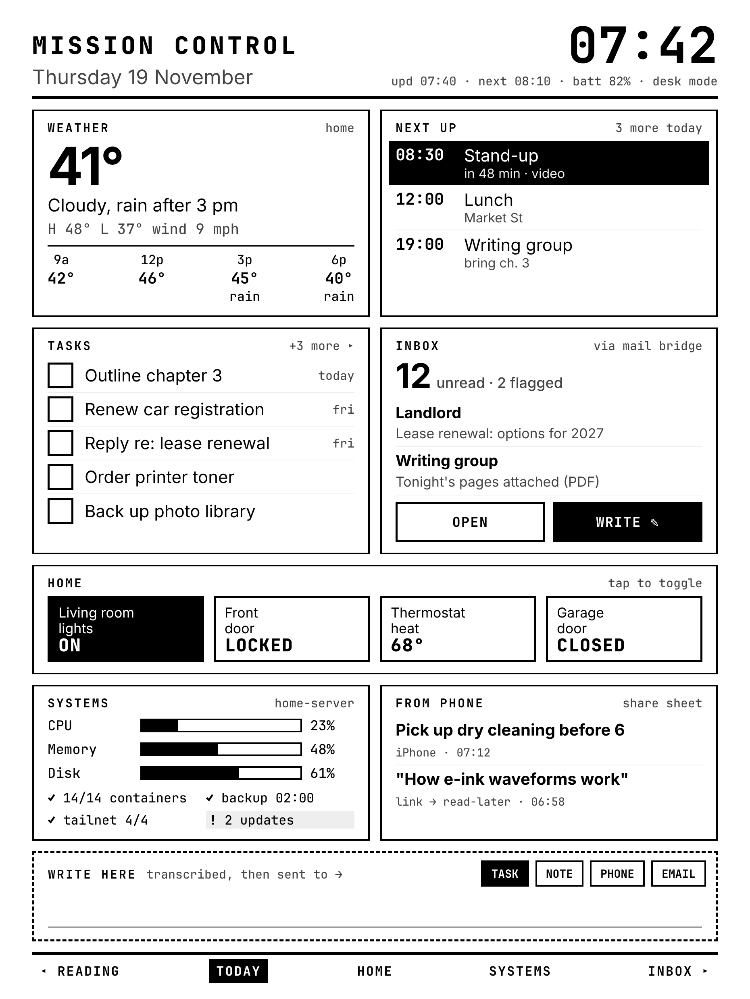
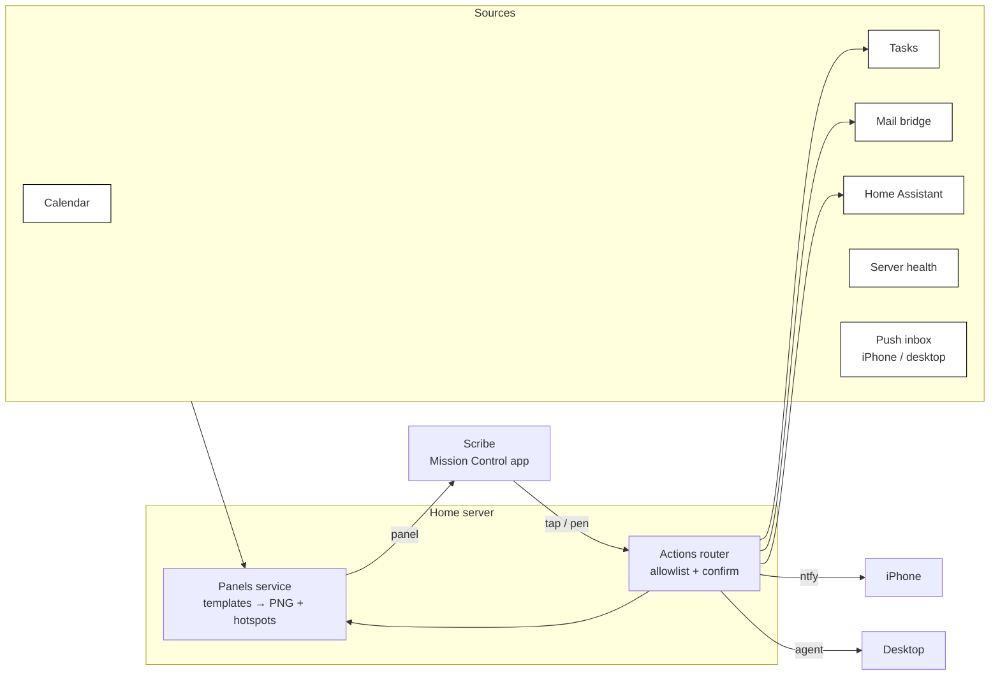

# Kindle Scribe Mission Control

Goal: make the jailbroken Scribe a **lo-fi extension of my iPhone and desktop**:

- a calm, always-on e-ink screen of custom dashboards
- tap controls
- pen capture
- two-way handoff with the phone and computer

Builds on `kindleScribeHub.md` (home server as hub, Tailscale) and `kindleScribeMail.md` (mail bridge, handwriting transcription).



*Mockup of the "Today" panel at the Scribe's exact resolution (1860×2480, 16 grays). All data is placeholder. Source: `missionControl/today.html`.*

---

## Principles

- **Lo-fi on purpose.** Refreshes every few minutes, not every second. No animation, no notification noise. High contrast and big type.
- **The server does the work; the Scribe is just the screen.** Panels are rendered on the home server, and the Kindle shows them and reports taps.
- **Design on the desktop.** Panels are plain HTML/CSS templates, so I can edit them on the desktop and preview them in any browser.
- **Private.** Everything runs over Tailscale. No secrets live on the Kindle.

---

## What already exists

| Option | What it does | Taps? | Why it isn't enough on its own |
|---|---|---|---|
| **TRMNL KOReader plugin** (+ self-hosted LaraPaper or Terminus) | Turns the Kindle into a TRMNL display. Large plugin library. TRMNL lists the Scribe at 2480×1860 | Not found | Display-only. One-time license. Self-hosting may need a plugin tweak (one write-up had to add the MAC address) |
| **hass-lovelace-kindle-screensaver** | Screenshots a Home Assistant dashboard as the sleep screen | No | Home Assistant only, display-only |
| **kindle-dash / kindle-dash-v2** | Server-rendered PNG drawn with FBInk, with Wi-Fi off and sleep between refreshes | No | Must shut down the Kindle UI while running (`STOP_FRAMEWORK`), so no reading. v2 is still a scaffold |
| **Browser kiosk** (an HTML dashboard in the Kindle browser) | Live Home Assistant tiles | Yes | Slow, and stops refreshing when the Kindle sleeps |
| **KOReader for Home Assistant** (HACS) | Kindle as a Home Assistant device: battery, reading stats. Home Assistant can send `show_message` and page turns | n/a | Commands arrive only when the Kindle checks in |
| **kindle-koreader-apps Home Assistant app** | Device control plus a dashboard mode | Yes | Home Assistant only |

Nothing combines **custom panels + taps + pen capture**, and still lets the Kindle work as a reader. So: build a **Mission Control app inside kindle-koreader-apps**, backed by a **panels service** on the home server. Reuse TRMNL or Home Assistant pieces where they help.

---

## Core idea: a panel = a PNG plus a hotspot map

1. The server fills an HTML template with live data and renders it to a **1860×2480 grayscale PNG** (16 levels).
2. Every element marked `data-action="…"` becomes a **hotspot**: an action name plus its x/y/width/height on screen. Example actions:
   - `task.done:t1`
   - `ha.toggle:light.living_room`
   - `panel:systems`
   - `capture.pen`
3. The Kindle app shows the PNG full-screen. A tap looks up the hotspot and `POST`s the action to the server. The server does it and returns the updated panel.

Why this shape:

- Any layout I can build in HTML works.
- The Kindle code stays small and generic.
- **A new panel needs no change on the Kindle.**

Native KOReader screens are only for what an image can't do: the pen canvas, keyboard input, and reading itself.

The prototype renderer already does steps 1–2: `missionControl/render.mjs` produces `today.png` and `today.hotspots.json` (28 hotspots).



---

## The panel set

| Panel | Shows | Taps |
|---|---|---|
| **Today** (mockup) | Time, weather, next events, top tasks, unread mail, home status, server health, items from the phone, capture box | Tick a task, toggle a device, open the inbox, write a reply, write to capture |
| **Home** | Rooms, scenes, thermostat, camera snapshots (dithered) | Toggles. **Locks and garage need a confirm** |
| **Systems** | Server CPU/RAM/disk, containers, backups, Tailscale devices, pending updates | Restart a container (with confirm), acknowledge an alert |
| **Inbox** | Mail bridge list | Opens the Mail app (`kindleScribeMail.md`) |
| **Reading** | Current book, KOReader stats, read-later queue (Wallabag) | Open the book, open an article |
| **Focus** | One big timer, the current task, a handwritten line for my intention | Start/stop the timer, mark the task done |
| **Week** | 7-day calendar grid and deadlines | Open a day |

---

## An extension of the phone and desktop

### Phone / desktop → Scribe

- **iPhone share sheet → "Send to Scribe"**: an iOS Shortcut that POSTs text, a URL, an image or a PDF to the server's `/push` over Tailscale.
  - Text shows up in the **From phone** card.
  - Files land in `/scribe/inbox` (Syncthing).
  - Links go to read-later.
- **Desktop**:
  - a `scribe push "…"` command, a hotkey, or a drop folder
  - **"show this on the Scribe"**, so a reference page, checklist or PDF sits on the e-ink screen next to the monitor while I work
- **Limit:** iOS doesn't let apps read other apps' notifications, so I can't simply mirror the phone. Instead, mirror the **sources** the server can see: mail, calendar, Home Assistant and server alerts.

### Scribe → phone / desktop

- **Capture box → phone**: handwriting is transcribed, then pushed to the iPhone through a self-hosted **ntfy** server.
  - For instant iOS delivery, set `upstream-base-url: https://ntfy.sh`.
  - Only the topic name goes upstream; the message itself stays on my server.
- **Capture → task / note / email**: the same transcription step as the mail bridge.
- **Desktop actions**: a small agent on the desktop, reachable over Tailscale, that runs a **fixed allowlist** of things: open a URL or file, start a focus playlist, lock the screen.

---

## Refresh and battery

| Mode | Refresh | Notes |
|---|---|---|
| **Desk** (on USB power) | Every 1–5 min | Fast partial refreshes, plus a full refresh about every 12 to clear ghosting (kindle-dash-v2's default) |
| **Battery** | Every 30 min to 3 h | Wi-Fi off between refreshes, sleep with an RTC timer to wake. Reported on other Kindles: **2–3 weeks at 30 min, 4–6 weeks at 3 h**. Not yet measured on a Scribe |

- A tap always wakes the screen and refreshes immediately. The header shows when the panel was last updated, so stale data is obvious.
- RTC wake behavior varies by model, so test it on the Scribe.
- KindleCron jobs more often than every 3 minutes keep the device awake.

---

## E-ink design rules (for templates)

- **Canvas**: 1860×2480 portrait (Scribe 2022/2024, 300 ppi).
- **Black and white first**, with a few grays, rendered down to 16 levels. Dither any photos.
- **Tap targets at least about 120 px** (about 1 cm at 300 ppi).
- **Body text at least 40 px** (about 10 pt). Monospace for numbers and times.
- **Inverted (black) blocks** for "now" and "on" states. They show up from across a room.
- **Always show how fresh the panel is.**

---

## Pieces to build

### Panels service (server, Docker)

- **Templates and data connectors**:
  - CalDAV/ICS calendars
  - weather API
  - tasks: Microsoft To Do, or a local store
  - the mail bridge
  - Home Assistant REST/WebSocket
  - server health (Glances, Uptime Kuma, Docker)
  - Wallabag
  - KOReader stats
- **Renderer**: Playwright + ImageMagick, with a cache (the prototype is `render.mjs`).
- **Actions router**:
  - only allowlisted action types
  - a `confirm` flag for risky ones: unlock, garage, send email, restart
- **Push inbox**: `/push` for the iOS Shortcut and the desktop command.
- **Security**: a revocable token per device, reachable on the tailnet only. **The Home Assistant token and mail credentials stay on the server.**

### Mission Control app (Kindle, a KOReader plugin in kindle-koreader-apps)

- **Panel viewer**:
  - `GET /panel/{name}` returns the PNG and hotspots, shown full-screen
  - swipe or tap the tabs to change panel
- **Taps**: `POST /action` returns the new panel, or a confirm dialog first.
- **Pen zones**:
  - `capture.pen` opens a full-page Notes canvas
  - the strokes go to `/transcribe`, then to the chosen destination
- **Scheduler**: desk/battery modes, partial vs full refresh.
- **Offline**: shows the last panel with a "stale" banner, and queues taps until it reconnects.
- **Settings**: server URL, token, panel order, refresh intervals.

---

## Build phases

0. **Done: mockup and renderer prototype**. `missionControl/` holds the HTML template, `render.mjs`, the PNG and the hotspot JSON.
1. **No Kindle code yet.**
   - A cron job on the server renders `today.png` every N minutes into the Syncthing folder.
   - I open it in KOReader's image viewer.
   - This tests readability, gray levels and ghosting on the real screen.
2. **Real data for Today**: calendar, weather, tasks, server health.
3. **Mission Control app**: viewer, swiping between panels, refresh schedule.
4. **Hotspots and actions**: tick tasks, Home Assistant toggles (confirm for locks), panel tabs.
5. **Phone and desktop push**: the iOS Shortcut and desktop command feeding the From phone card, plus ntfy back to the phone.
6. **Pen capture** → task / note / phone / email (shares the mail bridge's transcription).
7. **More panels**: Home, Systems, Inbox, Reading, Focus, Week.

## Trying the prototype

```sh
cd missionControl
npm install playwright        # Chromium; also needs ImageMagick for the grayscale step
node render.mjs today.html    # → today.png + today.hotspots.json
```

Install the Inter and JetBrains Mono fonts on the render server, or the panel falls back to DejaVu.

## Open questions

- Which 5 things matter most at a glance? That decides the first real Today panel.
- Calendar and task apps (iCloud, Google, Microsoft To Do…)?
- Is Home Assistant running, or planned?
- Will the Scribe mostly sit on the desk plugged in, or travel? That decides desk vs battery mode as the default.

## Sources

- TRMNL on Kindle Scribe: https://trmnl.com/byod/kindle-scribe
- TRMNL BYOS (self-hosted server): https://docs.trmnl.com/go/diy/byos
- LaraPaper (BYOS server): https://github.com/usetrmnl/larapaper
- Kindle dashboard approaches in 2026: https://terminalbytes.com/kindle-dashboard-eink-display-2026/
- Repurposing a Kindle as a dashboard (TRMNL plugin with self-hosting): https://intothevoid.github.io/posts/repurpose-an-old-kindle-and-use-it-as-an-e-ink-dashboard-2026-05-20.html
- kindle-dash-v2: https://github.com/AlexPagnotta/kindle-dash-v2
- RTC sleep/wake on Kindle (weather display): https://github.com/cdmckay/kindle-voyage-weather
- hass-lovelace-kindle-screensaver: https://github.com/sibbl/hass-lovelace-kindle-screensaver
- Controlling Home Assistant from a Kindle browser: https://community.home-assistant.io/t/controlling-home-assistant-with-a-kindle/1023913
- KOReader for Home Assistant: https://community.home-assistant.io/t/koreader-for-home-assistant-your-kindle-as-a-first-class-device/1011910
- ntfy iOS / upstream-base-url: https://docs.ntfy.sh/known-issues/
- ntfy self-hosted iOS notes: https://ramnode.com/guides/ntfy
- FBInk: https://github.com/NiLuJe/FBInk
- kindle-koreader-apps: https://github.com/Mcp20091/kindle-koreader-apps
