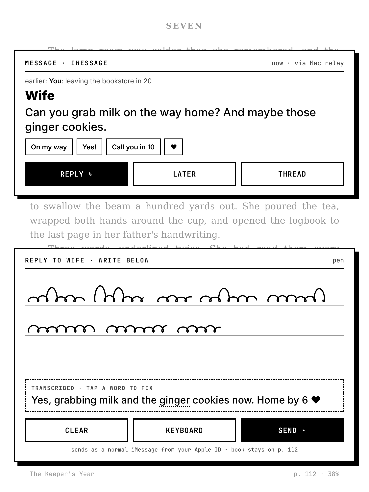
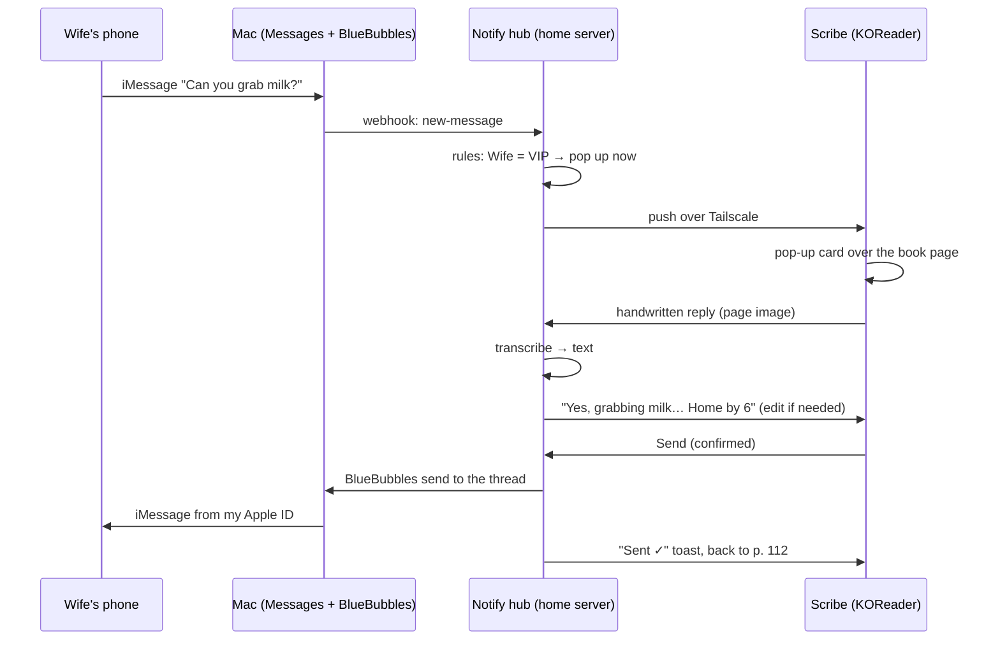

# Texts, Email and Notifications on the Kindle Scribe

Goal: while I'm reading or journaling on the Scribe, an important message (for example, a text from my wife) pops up over the page. I write a reply by hand, it's turned into text, and it sends as a normal text from my own number or Apple ID. Then I'm back on the same page.

Builds on `kindleScribeHub.md` (home server + Tailscale), `kindleScribeMail.md` (mail bridge and handwriting transcription) and `kindleScribeMissionControl.md` (panels and actions).

*Mockup: a text pops up over a book in KOReader, with the pen reply pad open. 1860×2480, 16 grays. Placeholder content; the book text is original filler. Source: `missionControl/messagePopup.html`.*

---

## The hard part: getting texts off the iPhone

iOS doesn't let apps read Messages or other apps' notifications. There are two practical ways around that:

| Path | Incoming texts | Replying from the Scribe | Needs |
|---|---|---|---|
| **A. Mac relay (BlueBubbles)**: recommended | Every iMessage as it arrives, plus SMS through the iPhone's Text Message Forwarding. Delivered by webhook | **Fully from the Scribe.** Sends as a real iMessage from my Apple ID | A Mac signed into Messages and left on: my desktop if it's a Mac, or a small used Mac mini |
| **B. iPhone Shortcuts automation** (no Mac) | Only from chosen contacts. Trigger "When I get a message from Wife" → **Get Contents of URL** POSTs the sender and text to the hub | **One tap on the phone.** The hub sends an ntfy notification; tapping it opens a "Send to Wife" shortcut pre-filled with my transcribed reply | Just the iPhone. Still unverified: whether it runs while the phone is locked, and how fast it fires |

### BlueBubbles notes

- Runs only on macOS, with iMessage activated.
- The basics work through AppleScript, plus polling the Messages database:
  - sending messages and attachments
  - receiving messages
- It has a REST API and **webhooks for new messages** (server 1.0.0+).
- The optional **Private API** requires **turning off System Integrity Protection**. It adds:
  - reactions, typing indicators and starting new chats
  - more reliable sending from a background macOS user, according to community notes
- **Start without it.** Replying to my wife's existing thread doesn't need it.
- Keep BlueBubbles on the LAN/tailnet. Don't turn on its public tunnel or proxy options.

---

## Email and everything else

- **Email**: the mail bridge keeps an IMAP IDLE connection open, so new mail arrives in seconds. VIP senders pop up; everything else is only counted. Replying by hand works exactly as in `kindleScribeMail.md`.
- **Anything that can send an HTTP POST** goes through the same hub:
  - Home Assistant (doorbell, washer finished)
  - calendar reminders
  - server alerts
  - ntfy topics
- **Other iPhone apps** (WhatsApp, Slack, and so on) can't be mirrored from the phone. That only works for services with their own API or a server-side bridge.

---

## How it flows

---

## Notify hub (server)

It extends the mail bridge and Mission Control server.

- **Inputs**:
  - the BlueBubbles webhook (path A) or the Shortcut POST (path B)
  - the mail bridge's IDLE connection
  - Home Assistant, ntfy, server alerts
- **One event format**: source, sender (contact name), thread, text, time, priority, `can_reply`.
- **Rules**:
  - VIP list. Wife always pops up, even in Do Not Disturb.
  - Others get a short toast or just a badge.
  - Quiet hours.
  - Bursts are collapsed ("3 new from Wife").
  - Duplicates are dropped.
- **Delivery**: push to the Kindle right away, and keep a queue so it can catch up on anything missed when it wakes.
- **Replies, routed by source**:
  - iMessage → BlueBubbles send to the same thread
  - email → mail bridge `/send`
  - path B → ntfy tap-to-send on the iPhone
- **Receipts**: "Sent ✓" goes back to the Kindle. Everything is logged.
- **Security**:
  - The BlueBubbles password, mail credentials and transcription key stay on the server.
  - The Kindle holds only a revocable token.
  - Tailnet only.

---

## On the Kindle (a Messages app in kindle-koreader-apps)

- **Listener**: `notificationlistener.koplugin` already shows this can work.
  - It runs a small HTTP listener inside KOReader (port 8787, with a token in the URL) and shows incoming messages while you read.
  - It's receive-only and GPL-3.0.
  - My app would do the same over Tailscale, and add replies.
- **Pop-up card** (see the mockup):
  - sender, the message, and my last message for context
  - **quick replies**: one tap sends, no transcription needed
  - **Reply ✎**, **Later**, **Thread**
  - Closing it returns to the exact page.
- **Reply pad**:
  - a half-screen pen pad → **Transcribe** (on the hub, the same as mail)
  - doubtful words are underlined and can be fixed by tapping them, or with the keyboard
  - **Send** → "Sent ✓"
- **Thread view**: the last ~10 messages.
- **Priority styles**:

  | Priority | Shown as |
  |---|---|
  | VIP | A card that stays until I tap it |
  | Normal | A small toast that disappears |
  | Low | Only a badge on Mission Control |

- **Do Not Disturb modes**:
  - Reading focus: VIP only
  - Journal: VIP only, or nothing
  - Quiet hours
- **Privacy**: an option to show only "New message from Wife" in toasts and on the sleep screen, without the text.

---

## When pop-ups can and can't appear

| Situation | Pop-up? |
|---|---|
| Reading in **KOReader**, writing in the suite's **Notes**, or Mission Control open | **Yes, within seconds** |
| Kindle **asleep** | Wi-Fi is off, so messages queue and show on wake ("2 new"). Options: keep it awake in desk mode (plugged in), or wake every N minutes to check and update the sleep screen with a summary (costs battery) |
| Amazon's **stock reader or stock notebooks** | **No.** I found no proven way to put an interactive pop-up over Amazon's own interface. The low-level leads (drawing straight to the screen with FBInk, or the Kindle's internal "pillow" dialog layer) are unproven. **Read in KOReader and journal in Notes to get pop-ups** |

- Wi-Fi has to stay on while I'm using the Kindle, so set these in KOReader's network settings:
  - do **not** "disable Wi-Fi when inactive"
  - **do** "restore Wi-Fi connection on resume"
- Expect somewhat shorter battery life while reading.

---

## Build phases

1. **Prove the pop-up, with no server code.**
   - Install `notificationlistener.koplugin` on the Scribe.
   - Make an iPhone Shortcut automation: "When I get a message from Wife" → POST the text to the Kindle's listener. Both devices are on Tailscale, so this should work away from home too; needs testing.
   - Read a book and wait for her next text.
2. **Hub + Mac relay**: BlueBubbles webhook → hub → Kindle, with the VIP and Do Not Disturb rules.
3. **Messages app**: pop-up card, quick replies, Later, thread view.
4. **Handwritten replies**: pen pad → transcription → send through BlueBubbles → "Sent ✓".
5. **Email and other sources** through the same hub, with the priority styles.
6. **Sleep-screen summary and always-on desk mode.**

## Open questions

- **Is the desktop a Mac, or is a small always-on Mac an option?** That decides fully two-way (path A) vs one-tap-on-phone replies (path B).
- **Who is VIP?** Just my wife, or kids, family, work?
- **Where do I journal now?** In stock notebooks or in KOReader/Notes? Pop-ups only work inside KOReader.

## Sources

- BlueBubbles server overview: https://docs.bluebubbles.app/server
- BlueBubbles REST API and webhooks: https://docs.bluebubbles.app/server/developer-guides/rest-api-and-webhooks
- BlueBubbles Private API (SIP): https://docs.bluebubbles.app/private-api/installation
- BlueBubbles without the Private API: https://missblue.dev/blog/openbubbles-vs-bluebubbles
- BlueBubbles background-sending note: https://github.com/NousResearch/hermes-agent/issues/116395
- BlueBubbles webhook events (third-party integration): https://docs.openclaw.ai/channels/bluebubbles/index.html
- iOS Message automation → web request: https://forwardsmsapp.com/blog/how-to-set-up-shortcuts-automation-on-ios-27/
- Get Contents of URL (Apple): https://support.apple.com/en-au/guide/shortcuts/apd58d46713f/ios
- notificationlistener.koplugin: https://github.com/omer-faruq/notificationlistener.koplugin
- KOReader InfoMessage widget: https://koreader.rocks/doc/modules/ui.widget.infomessage.html
- Kindle window layers / pillow alerts: https://wiki.mobileread.com/wiki/Running_X_apps_on_Kindle_Touch
- ntfy iOS delivery: https://docs.ntfy.sh/known-issues/
