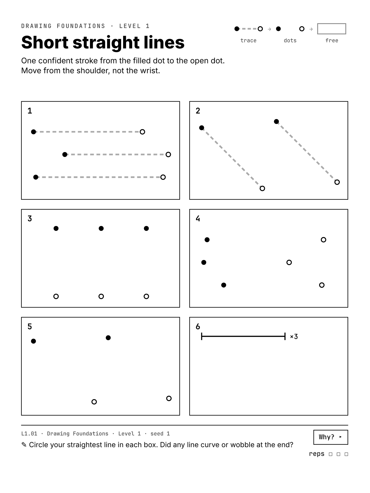

# Pen Practice Series: Drawing and Handwriting on the Kindle Scribe and Pen Tablets

Status: brainstorming. Started from a long Google AI brainstorm. This doc keeps what's strong in it, corrects what's shaky, and turns it into a buildable plan.

**Working prototype:** `penPractice/`. It turns lesson files into a true-size PDF for the Scribe.



---

## Keep: the strong ideas

- **Micro-skill lessons with lots of repetition**: 4–8 cells or rows per page, all practising one thing.
- **Help that fades within a page**: **trace → dots → free**.
- **Two layers**:
  - The practice page works without reading: icons, dots, arrows.
  - A **"Why?"** page explains the mechanics for anyone curious.
- **The curriculum is data**: one lesson format for every track, plus **generated targets** so there's fresh practice every day.
- **Self-check rather than grading**: circle your best attempt, and repeat the page tomorrow.
- **The drawing path**: lines → curves and ellipses → boxes and simple solids → combining them → light and shading → drawing from life.
- **One engine for all lettering styles**: ruled lines (ascender, x-height, baseline, descender) plus a slant guide work for print, block caps, cursive, sans lettering and bubble letters.

---

## Reality checks

1. **Who can use it is the biggest issue.** The Google plan only runs on a **jailbroken** Scribe:
   - only 2022/2024 models, on specific firmware (Vera's range)
   - a real risk of bricking the device
   - not something to ask parents, kids or customers to do
   - the 3rd-gen Scribe and Colorsoft can't run it at all

   **The series has to work on stock devices first.**
2. **"Near-zero-latency ink" isn't true today.**
   - Ink in KOReader-based apps on the Scribe was measured at **~150–250 ms** behind the pen, vs **~30–60 ms** in Amazon's notebooks.
   - The Scribe's display controller is **MediaTek (hwtcon)**, not the i.MX "EPDC" the plan names.
   - FBInk documents a **pen mode** with strict rules (fast DU updates only, small areas, no mixing with other updates). It's untested on a real Scribe.
3. **Tilt and pressure claims are unverified.**
   - Nobody has confirmed whether the Scribe's digitizer reports tilt to Linux, or what pressure range it reports.
   - Check with `evtest` on the device before designing anything (like graffiti chisel nibs) around tilt.
   - "4096 levels + tilt" claims come from sellers of aftermarket pens.
4. **Automatic grading needs an app.**
   - Stroke measurements are doable when the app owns the ink: straightness, how close a line ends to its target, how even an ellipse is.
   - They're impossible on a stock Scribe PDF.
   - Keep feedback gentle and optional, especially for kids.
5. **Names and IP.**
   - **"Helvetica" is a trademark.** Call the track **Swiss Sans** or **neo-grotesque lettering**, don't ship Helvetica font files, and use open fonts (e.g. Inter, OFL-licensed) for examples.
   - The drawing sequence (lines, "ghosting", ellipses, boxes) closely follows **Drawabox**'s well-known free course. The fundamentals are common knowledge, but **write original exercises and wording**.
   - School handwriting models often have trademarked names. Describe styles generically and offer "match your school's style" variants.
6. **What the brainstorm missed.**
   - **Left-handed versions**: stroke direction, slant and layout. The prototype has `--left`.
   - **Kids**: age bands, bigger guides, fewer cells per page, 5–10 minute sessions, playful prompts, no scores, and notes for parents and teachers.
   - **Lesson 0**: grip, posture, and how to hold the pen on glass.
   - **Session shape**: warm-up page → main lesson → "repeat tomorrow".
   - **Graffiti for kids**: rename it **Bubble & Block Letters**. Street styles belong in the adult track.
   - **Accessibility**: high contrast and large-print versions.

---

## Product shape: one curriculum, three outputs

The curriculum (lesson files plus stroke data) is the real asset. Each output is just a different way of drawing it.

| Output | Runs on | What it can do | When |
|---|---|---|---|
| **1. PDF workbooks** | **Stock Kindle Scribe, every model** (write directly on PDFs sent to it), reMarkable, Boox, Supernote, iPad apps (GoodNotes, Notability), and print | Fading guides, working links (contents, "Why?" pages), a new seed = a new edition. Sell where Scribe templates already sell (Gumroad, Etsy) | **v1** |
| **2. Tablet app** | **iPad + Apple Pencil** first (pressure, tilt and low latency all work well there), then Android styluses | Peek at the ideal guide over your own ink, replay strokes, gentle measurements, a progress timeline, endless generated drills, a kids mode | v2 |
| **3. Jailbroken Scribe player** | KOReader plugin reading the same lesson files | The interactive features on e-ink. Wait until "Fast ink" pen mode is proven | Side project / open source |

---

## Series lineup (draft)

- **Drawing Foundations 1–3**
  - Lines and curves → boxes and simple solids → shading and drawing from life
  - Original exercises, following the brainstorm's levels
- **Handwriting**:
  - Everyday Print
  - Block Caps (architectural)
  - Cursive
  - Swiss Sans Lettering
  - Bubble & Block Letters (kids) / Street Lettering (adults)
- **Kids editions**:
  - Little Hands (ages 5–7): print letters and shapes, big guides
  - Junior Artist (ages 8–11)
- **Adult editions** of each track.
- **Book size**: about 20 lessons, each with 1 practice page and 1 repeat page with fresh targets, plus "Why" pages.

---

## Lesson format

The prototype's format is smaller than Google's but adds what was missing:

```json
{
  "id": "L1.01",
  "track": "Drawing Foundations · Level 1",
  "title": "Short straight lines",
  "objective": "One confident stroke from the filled dot to the open dot…",
  "type": "line-drill",
  "audience": "all",
  "length_mm": [32, 55],
  "cells": [
    { "guide": "ghost", "orientation": "horizontal" },
    { "guide": "dots",  "orientation": "vertical" },
    { "guide": "free",  "orientation": "horizontal" }
  ],
  "self_check": "Circle your straightest line in each box…",
  "deep_dive": "Speed helps straightness…"
}
```

- **Sizes are real millimetres**, so drill lengths match the real world on the Scribe.
- **Planned additions**:
  - `handedness`
  - age `audience` bands
  - more drill types: `ellipse-drill`, `box-drill`, `value-scale`
  - `strokes`: hand-recorded pen paths for each letter, for **stroke-order arrows and replay**. Fonts only give outlines, not stroke order, so these need to be recorded once with a pen.

---

## Prototype (built)

- **Files**: `penPractice/build.mjs` reads `penPractice/lessons/*.json` and writes `penPractice/out/pen-practice-sampler.pdf` plus PNG previews.
- **The sampler's four pages**:
  1. cover with linked contents
  2. **L1.01 Short straight lines** (dot-to-dot, trace → dots → free, plus a length-matching box)
  3. **P1.05 Arches: n m r h** (large examples with start dots and pull-down arrows, then ghost rows → start dots → free ruling)
  4. "Why it works"
- **True size on the Scribe**: the page is 157.5 × 210 mm, the Scribe's screen. It's 3:4, so it scales to iPad and reMarkable, and prints on A5.
- **Options**:
  - `--seed N` gives fresh targets
  - `--left` gives the left-handed variant (horizontal lines start on the right)
- **Start dots** are measured from the rendered font, so changing the font moves them too.

```sh
cd penPractice
npm install playwright                       # also needs ImageMagick for the PNG previews
node build.mjs lessons/*.json                # → out/pen-practice-sampler.pdf
node build.mjs --seed 7 --left lessons/*.json
```

**Try it on the Scribe**:

- Send `pen-practice-sampler.pdf` with Send to Kindle, open it, and write on it with the pen.
- Check three things:
  - the page fills the screen
  - the links work
  - writing on it feels smooth
- Amazon expanded pen writing on sideloaded PDFs in firmware 5.19.3.0.1. Older firmware may behave differently.

---

## Next decisions

1. **First book**: kids' print handwriting, adult Drawing Foundations 1, or lettering?
2. **PDF first** (recommended) or app first?
3. **Series name and look**.
4. **Example font** for print (an open-license literacy font), and who records the stroke paths.

## Sources

- Scribe pen latency in KOReader-based apps, MediaTek hwtcon pen mode (GZreader PR #280): https://github.com/9retirement6irk/GZreader/pull/280
- Open question on Scribe pen pressure/tilt over evdev: https://www.mobileread.com/forums/showpost.php?p=4493107
- Early Scribe pen/digitizer reports: https://liliputing.com/amazon-kindle-scribe-is-a-10-2-inch-e-ink-writing-slate-for-340/
- Wacom kernel event codes (pressure, tilt): https://developer-docs.wacom.com/docs/icbt/linux/kernel-events/kernel-events-basics/
- Vera jailbreak device/firmware range: https://blog.the-ebook-reader.com/2026/08/14/how-to-jailbreak-kindles-and-install-koreader-using-vera-video/
- Writing on sideloaded PDFs (5.19.3.0.1): https://www.techwalla.com/13779365/kindle-update-519301-fixes-battery-drain-and-adds-pdf-tools
- Custom PDF templates on the Scribe: https://www.techradar.com/tablets/i-gave-my-kindle-scribe-note-taking-super-powers-heres-how-you-can-too
- Drawabox (free drawing fundamentals course): https://drawabox.com
