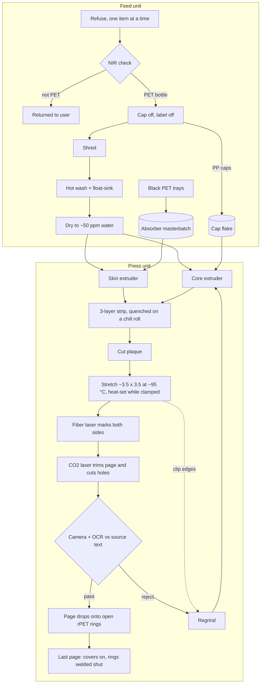

# Barrett Press: design v0.2

*Status: proposal, 2026-10-30. Builds on [review.md](review.md). Numbers marked "estimate" are first-pass calculations to check on a prototype.*

**Goal:** a fully durable book made of 100% recycled plastic, from a standalone printer that takes in refuse and turns out classic novels a page at a time.

## 1. Holes in the goal as it stands

1. **"100% recycled" conflicts with the chat's additive list.** Stabilizers, a white pigment, and an antimony laser additive are all virgin materials.
   *Fix:* source the functional additives from waste too. Polypropylene bottle caps can make the page white (2.2), and a trace of black PET food tray can act as the laser absorber. That leaves at most one virgin additive, a hydrolysis stabilizer, and only if aging tests show it's needed.
2. **The chat's process is a factory, not a printer.** A tenter-frame film line, solid-state polymerization reactor, fiber spinning line and industrial wash plant don't fit in an appliance.
   *Fix:* make film one page at a time with a batch stretcher (3, module 8), and cut the steps that only matter at industrial scale.
3. **Refuse isn't feedstock.** Most refuse is not PET, and some lookalikes ruin a PET melt even in traces: PVC releases acid, and PLA softens and gums up dryers.
   *Fix:* the intake identifies every item and returns anything that isn't PET.
4. **Wet PET plus heat makes a brittle book.** If PET melts with moisture in it, its chains break.
   *Fix:* dry it to about 50 ppm water right before melting. Bottle-grade PET (intrinsic viscosity around 0.75–0.85 dL/g) has longer chains than film needs (around 0.6). Good drying keeps that margin, which becomes the book's aging budget.
5. **A clear page can't be read.** You'd see the text on both sides of the page, and the pages behind it.
   *Fix:* a layered page with an opaque white core (2.1).
6. **250-micron pages are far too heavy.** Pride and Prejudice would weigh 2.1 kg and use about 270 bottles.
   *Fix:* a 125-micron layered page brings it to 0.95 kg and about 120 bottles (2.3).
7. **The hinge is the life-limiting part.**
   *Fix:* a binding where pages pivot without bending (2.1), so brittleness in old age no longer snaps them at the spine.
8. **Glossy plastic pages glare in sunlight and cling to each other with static.**
   *Fix:* a matte surface texture pressed in during forming. It needs no additive, and it also takes pencil notes like drafting film.
9. **The 10,000-year claim is unproven.**
   *Fix:* write a durability spec and claim only what accelerated aging proves (section 5). The realistic starting target is the polyester microfilm benchmark of about 500 years indoors.
10. **The machine has safety and nuisance problems.** Burning PET with a laser makes fumes, the lasers are Class 4, melt temperatures are around 280 °C, wash water has to go somewhere, and shredders are loud.
    *Fix:* use a fully enclosed, interlocked cabinet with fume extraction (HEPA plus activated carbon), and keep the dirty steps in a separate unit (section 3).
11. **"A page at a time" means hours per novel, not minutes.**
    *Fix:* set expectations. The estimate is one page every 1–3 minutes, so a novel takes about a working day (section 4).
12. **"Classic" doesn't always mean "free to print".**
    *Fix:* ship a public-domain catalog and check the rules for each country (section 6).

## 2. Recommended book (v0.2)

### 2.1 Spec

| Part | Spec | Why |
|---|---|---|
| Polymer | Recycled PET from bottles for everything: pages, rings, covers | One material ages evenly, can be welded to itself, and the finished book can be fed back into the machine |
| Page | 125 µm total, in 3 layers: 20 µm clear skin / 85 µm white core / 20 µm clear skin, stretched in both directions and heat-set | Opaque, strong, and less than half the weight of the chat's page |
| White core | Microvoids made by blending ~10% polypropylene from bottle caps into the core, which open up when the film is stretched | White without titanium dioxide; voided white polyester film is an established product. It also makes the core lighter (~1.0 g/cm³ vs 1.39) |
| Laser absorber | Trace carbon black from black PET trays, in the skins only | Replaces the virgin antimony tin oxide. A few trays make enough masterbatch for thousands of pages |
| Text | Laser char inside the skins, on both sides | Protected from abrasion and can't be washed off; dark text on a white page |
| Surface | Matte, textured by the press and stretch tooling | Less glare and static cling; takes pencil notes |
| Size | A5 (148 × 210 mm), ~330 words per side | Trade-paperback reading size |
| Binding | 3–4 rPET rings through laser-cut holes; pages pivot on the rings and never bend | Removes the hinge failure from turn 12. Pages drop onto open rings as they're printed, so the book grows on its own binding |
| Covers | 1.5 mm rPET board pressed from colored bottle flake, with a marbled look and laser-marked title, on the same rings | Uses the lowest-value colored-PET stream; same material as the rest of the book |
| Long books | Over ~250 leaves, split into volumes | Many classics first appeared in volumes: Pride and Prejudice in three, and *The Whale* (Moby-Dick) in three |
| Stabilizer | None by default. If tests demand it, ~1% polycarbodiimide in the skins only | The one possible virgin additive; the skins carry both the strength and the text |

Your braided cord stays an option for a hand-finished edition. It laces through the same holes, with its ends welded, and can be made from bottle strips (the way the open-source Polyformer turns bottles into filament). Rings are the default because they're easy to automate and keep the pages from bending.

### 2.2 What "100% recycled" means here

- **Polymer:** 100% recycled. That's PET from bottles, polypropylene from caps, and the PET carrying the carbon black from trays.
- **Virgin content:** none in the default build. At most about 1% polycarbodiimide in the skins if aging tests show it's needed. Say which on the label.

### 2.3 Weight and bottles (estimates)

The figures assume 500 mL bottles yielding about 8 g of usable PET each, plus covers and rings.

| Novel | Leaves | Chat spec (250 µm) | v0.2 (125 µm) | Block thickness, v0.2 |
|---|---|---|---|---|
| Frankenstein | 114 | 1.37 kg, ~170 bottles | 0.64 kg, ~80 bottles | 14 mm |
| Pride and Prejudice | 185 | 2.14 kg, ~270 bottles | 0.95 kg, ~120 bottles | 23 mm |
| Moby-Dick | 317 | 3.57 kg, ~450 bottles | 1.53 kg, ~190 bottles | 40 mm (split into volumes) |

A paperback Pride and Prejudice weighs about 0.4–0.5 kg. v0.2 is roughly twice that, which is a fair price for a book you can hose down. A 100 µm page (15/70/15) would bring Pride and Prejudice to 0.79 kg if handling tests allow it.

## 3. The standalone press

There are two units:

- **Feed unit:** the dirty, wet, noisy part. Refuse goes in and clean, dry flake comes out.
- **Press unit:** the clean part. Flake goes in and bound books come out.

Splitting them also lets the press ship first, running on purchased recycled flake while the feed unit is still being developed.

| # | Module | What it does | Precedent | Risk |
|---|---|---|---|---|
| 1 | Intake and ID | Takes one item at a time. An NIR sensor separates PET from PLA, PVC and PETG lookalikes, and sorts caps into PP or HDPE; everything else goes back. NIR can't see black plastic, so black trays go in a separate slot that the user confirms | Reverse-vending machines; handheld NIR plastic scanners | Medium |
| 2 | Decap and delabel | Removes caps and labels. Shrink sleeves (often PVC or PETG) are rejected. Early versions can ask the user to do this | Manual at first | Medium |
| 3 | Shredder | Cuts bottles into 5–10 mm flake | Precious Plastic shredder (open-source small-scale recycling) | Low, but loud |
| 4 | Wash | Hot-water friction wash plus a float-sink tank (caps and labels float, PET sinks), with filtered, recirculated water. Caustic is optional; books aren't food-contact | Industrial wash lines, scaled down | Medium (water, odor) |
| 5 | Dryer | Vacuum or desiccant drying at ~160 °C for 4–6 h, down to ≤50 ppm water | Standard small PET hopper dryers | Low, but slow |
| 6 | Co-extruders | Two mini extruders feed one die. The skin extruder runs clean PET plus absorber; the core runs PET, cap PP and regrind. Output is a strip ~70 mm wide and 1.5 mm thick, chilled so it stays amorphous | Lab co-extrusion lines | Medium |
| 7 | Plaque cutter | Cuts the strip into ~70 × 90 mm plaques | Simple shear | Low |
| 8 | Page stretcher | Clamps the plaque in a clip frame, heats it to ~95 °C, stretches it ~3.5× each way at once, heat-sets it at ~210–230 °C while still clamped, then cools it | Laboratory film stretchers do exactly this, one sample at a time | **High: the core R&D** |
| 9 | Marking | A 1064 nm fiber laser with galvo mirrors, with one head above and one below so the page never needs flipping. ~15–20 s per side (estimate) | Industrial laser marking; laser-engraved ID cards | Medium |
| 10 | Trim and holes | A CO2 laser (PET absorbs 10.6 µm strongly). It leaves sealed, smooth edges with fewer micro-cracks than punching. A heated die is the fallback | Standard | Low |
| 11 | Inspection | A camera reads each page and compares it with the source text by OCR. Misprints go to regrind | Print inspection systems | Low |
| 12 | Output and binding | Pages stack in order on open rPET rings. After the last page, the covers go on and the ring ends are welded shut (hot plate or ultrasonic) | Ring and coil binding | Low |
| 13 | Regrind loop | Clip edges and rejects go back to the core extruder. The number of re-melts is capped because each one shortens the chains | Standard practice | Low |
| — | Enclosure | Class 1 laser enclosure with interlocks, fume extraction (HEPA plus activated carbon), and a typesetting computer | Laser cutters | Low |

## 4. Rough numbers (estimates)

- **Throughput:** forming a page takes ~1–2 min and marking it ~40 s, so pipelined, one page every ~1–3 min. Pride and Prejudice (185 leaves) takes roughly 4–9 hours.
- **Plaque yield:** a ~13 g plaque becomes a 4.4 g page, so about two-thirds goes back as regrind. The stretcher's clip design is where yield improves.
- **Feed per Pride and Prejudice:** ~120 bottles plus ~20 PP caps (about 10% of the ~490 g core).
- **Energy:** heaters dominate. ~3–4 kW running for a working day comes to ~25–30 kWh per novel, a few dollars of electricity. Running in batches matters more than any single module's efficiency.

## 5. Durability spec and tests

A book is "fully durable" when it passes these targets. They're first proposals, to be tightened once there's data.

| Property | Target | Test |
|---|---|---|
| Hydrolysis life | Time until elongation at break falls to 50% of new, at 23 °C / 50% RH. Report the number rather than assume it; initial goal ≥500 years | Damp heat at three or more temperatures (e.g. 60, 70 and 85 °C at 85% RH), tracking intrinsic viscosity and elongation, then fit an Arrhenius curve |
| Water | No change after 7 days submerged | Immersion, then tensile test (ASTM D882) |
| Text wear | Still legible after heavy abrasion | Taber abrasion (ISO 9352), then OCR legibility |
| Page turns | 10,000 turns per leaf with no cracks at the holes | Page-turning rig |
| Tear | At least as tear-resistant as a good paperback page | Elmendorf tear (ASTM D1922) |
| Temperature | No warping across −30 °C to +60 °C cycling | Thermal cycling |
| Drop | No damage from 1.5 m onto concrete | Drop test |
| UV (field copy only) | Set from how many hours a year you'll read outdoors | Xenon-arc weathering (ISO 4892-2) |

On UV: a book read on a mountainside for a few hours a week absorbs a small fraction of the UV a book left outdoors would. A UV absorber, which would be virgin, is only worth adding for a "field copy" variant if the xenon-arc numbers call for it.

## 6. Content pipeline

- **Source texts:** Project Gutenberg plain text.
- **Public domain:** in the US, works published in 1930 or earlier are public domain as of 2026. Other countries mostly use the author's life plus 70 years, so check before shipping a catalog there.
- **Typesetting:** the whole book is typeset before page 1, using Typst or TeX, so the page count, page numbers and running heads are fixed in advance. Any single page can then be reprinted on its own.
- **Printing:** each page goes to the lasers as vector outlines, both sides at once.

## 7. Build plan

| Phase | Build or buy | Exit test |
|---|---|---|
| 1. Prove the page and the book (weeks) | Buy commercial white and clear PET films and a desktop fiber laser marker; use a CO2 laser cutter for trimming and holes. Hand-bind a 20-page sample on rPET rings and set up typesetting from Gutenberg texts. Start damp-heat aging on the bought films right away, since it takes months | Sharp marks inside the skin; pages turn on the rings with no bending; aging tests underway |
| 2. Make the page | Buy recycled PET pellets. Build the dryer, two mini extruders, plaque cutter and a single-page stretcher | A stretched, heat-set, opaque page that matches the bought film on tensile, tear and early aging results |
| 3. Feed unit | Intake with NIR, shredder, wash, dryer | Flake from mixed refuse with no PVC/PLA and intrinsic viscosity still ≥0.7 dL/g |
| 4. Integrate | One cabinet: automation, OCR check, regrind loop, enclosure, fume extraction, and a "pick a novel" screen | A complete Pride and Prejudice from bottles in one run |

## 8. Biggest risks and the experiment that retires each

1. **Batch stretching may not give uniform, strong page-size film.** Build the single-page stretcher first, then map thickness and test tensile strength across the page.
2. **Cap PP may not make the core opaque enough.** Run blend trials at 5–15% PP and measure opacity after stretching.
3. **Recycled carbon black may not give sharp dark marks inside the skin.** Run a laser settings matrix on film samples with absorber loadings from 10 to 1,000 ppm.
4. **Real lifetime is unknown.** Start damp-heat aging in Phase 1 and keep it running; it is the slowest thing in the project.
5. **Appliance-scale washing may not get flake clean enough.** Measure intrinsic viscosity and contamination after a single wash-and-dry cycle.

## 9. Decisions for you

1. **Page size:** A5 (148 × 210 mm), or something else?
2. **Binding:** rings by default (automatable), with your braided cord as a hand-finished edition?
3. **Stabilizer:** allow the one possible virgin additive (~1% stabilizer in the skins) if aging tests show it's needed, or stay strictly 100% recycled and accept whatever life the tests show?
4. **Edition:** reading copy only, or also a UV-protected field copy?
