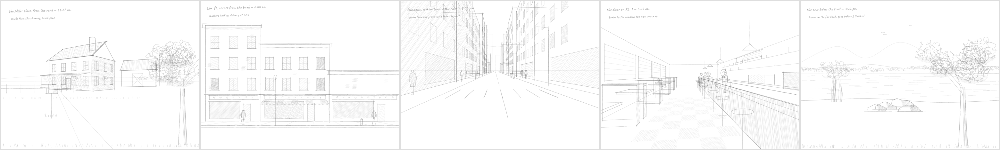

# Sketch Art: Pencil Illustrations for the Pen Practice Books

**House style: pencil sketches from an observer's sketchbook.** Think of someone who sits in a mall, a diner booth or a parked car and draws what's in front of them:

- perspective worked out properly
- quick lines that overshoot their corners
- hatching for shade, and scribbled foliage
- graphite grain
- a couple of handwritten margin notes (a place and a time, plus one thing they noticed)



## Scenes

| Scene | What's in it |
|---|---|
| `farmhouse` | Two-storey farmhouse with porch and chimney, barn with X-braced door, silo, fence, lane, mailbox, big tree |
| `buildingFront` | Three shopfronts across the street: cornices, window grid, sign bands, striped awning, brick, lamp post, hydrant, people |
| `cityStreet` | One-point perspective down an avenue: building faces with windows and shopfronts, lamp posts, crosswalk, parked cars, distant skyline, overhead wire, people |
| `diner` | Counter with stools and regulars seen from behind (one in a cap), cook, back bar with shelves, coffee machine and pie case, menu board, pendant lamps, booths under the windows, checkered floor |
| `nature` | Lake with far ridge and tree line, reflections, boulders, reeds, a big tree in the foreground |

**Every seed is a new sketch:** layout, building sizes, who's sitting where, trees and notes all change. All content is original and generated, so there are no rights to clear.

## Use

```sh
cd sketchArt
node sketch.mjs --seed 3                      # 5 scenes + contact sheet in out/
node sketch.mjs --seed 3 --only diner,nature  # just some scenes
node sketch.mjs --seed 3 --no-notes           # without the handwritten notes (clean reference)
node sketch.mjs --seed 3 --size 3720x2790     # double size for print
```

- **Output per scene**: an **SVG** (vector, any print size, font embedded) and a **PNG** dithered to the Scribe's 16 grays.
- The default is 1860 × 1395 (4:3). That's the Scribe's full width, so a scene fills the top two-thirds of a portrait page.
- **Requires**:
  - Playwright (Chromium) and ImageMagick
  - the Caveat handwriting font, included in `fonts/` (SIL Open Font License; licence in `fonts/Caveat-OFL.txt`)

## How it works (short)

- **Pencil line**: a ruled-by-eye stroke that overshoots its ends, bows slightly and often gets a lighter second pass. A graphite-grain filter breaks it up like pencil on paper.
- **Perspective**: a small pinhole camera in metres. Buildings, counters, stools and cars are 3D boxes, and only the faces that point toward the viewer are drawn. Windows and signs sit on those faces.
- **Shading**: hatching clipped to a shape, cross-hatched for darker values.
- **Foliage and hair**: a looping scribble that tours the whole area.
- **People**: a few gestural lines, standing or seated from behind. That's how they appear in a quick observational sketch.

## In the books

- **Sketch What You See**:
  - reference pages ("draw this street")
  - "spot the perspective" overlays (the camera knows the horizon and vanishing points, so a guide version can show them)
  - before/after examples
- **Clear & Quick Print**: the margin notes are a natural prompt to "write a field note in block print under your sketch".
- Covers, part openers, and the free sampler.
- `--no-notes` gives a clean reference for exercises. The noted version gives the sketchbook mood for covers and openers.

The earlier sumi-e ink generator is still in `inkArt/` as an alternative style.
